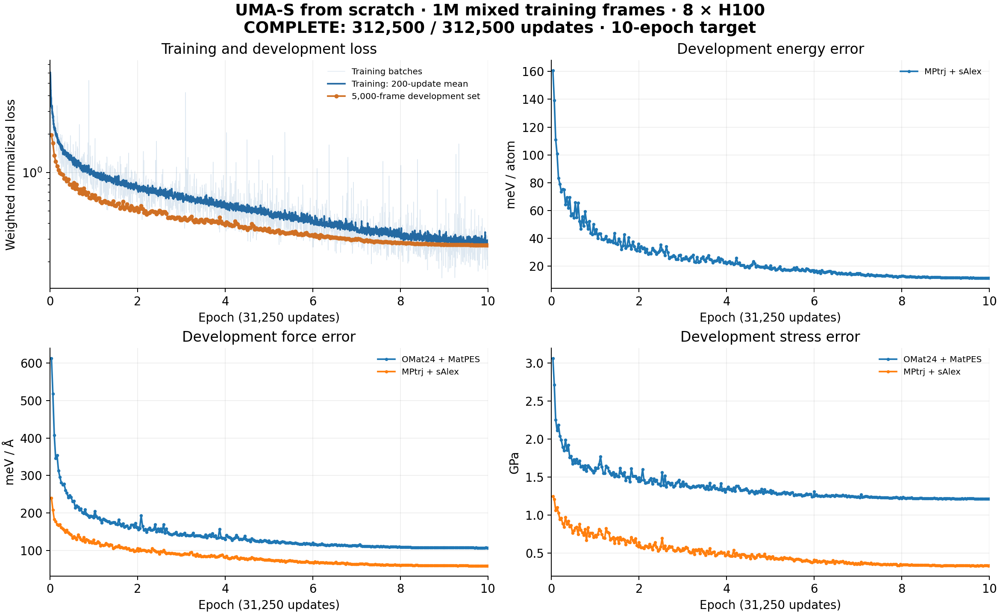

# Pretraining integration and mixed-source trial

## Expanded task

- PR #90 merged into PR #89: 42,409,826-frame (~91 GB) pool, eight suites, 4,312 validation /
  9,071 test cases, fixed simulation drivers and separate offline verifier/grader.
- Random UMA-S starter, training-only offsets/normalization, no pretrained weights in agent mounts.
- Starter sample: 498,841 train / 4,995 labeled dev, with the v2 exclusions. Other pool selections
  must keep reduced compositions and parent IDs disjoint between train and labeled dev.
- Score v2 uses equal suite weights and fixed scales from the rounded MP 3-epoch validation table
  in PR #90. All 15 raw metrics remain. This is not interchangeable with Score v1.
- κ normalization now uses reference quadrature weights and reference initial symmetry, so
  submitted metadata cannot reduce the error. Mixed-replay selection now reduces compositions
  and guards parent membership; historical mixed-replay results are not corrected-run evidence.

## Interrupted 30-epoch pilot (v1)

| Setting | Value |
| --- | --- |
| Run | `scratch-30ep-500k-20261001-01` |
| Initialization | Random UMA-S backbone/head, 146,566,305 trainable parameters |
| Data | Original 500,000 train / 5,000 labeled-dev MPTrj+sAlex frames |
| Compute | 8×H100; global batch 32; seed 41; 468,750 updates |
| Schedule | 30-epoch cosine; six resumable five-epoch segments |
| Checkpoint selection | Minimum labeled-dev loss among saved checkpoints |
| Evaluation | 28 diagnostics, then 1,200 v1 physical-validation cases; final checkpoint also if different |
| Score | Frozen three-suite Crystal Potential Score v1 |
| Test | No final-test evaluation by this trial |
| Current result | Stopped by user at last reported step 306,300 (~19.60 epochs); committed checkpoints at 300,000 and 305,000 retained |

The original sample predates the five added suites' exclusions: 1,159 train / 5 dev frames are
removed in the expanded starter. This run therefore cannot be presented as a clean eight-suite
baseline. Both run-owned apps are stopped and its tracker is paused. It did not reach final physical
validation; no completed 30-epoch result is claimed. PR #90 has already published
historical pretrained test scores; “test unused” applies only to this scratch trial.

Historical pretrained comparisons: 3 epochs took 2 h 16 min; 30 epochs took 25 h 5 min.
Their Score v1 values were 50.00 (3ep), 47.33 (selected 30ep) and 48.15 (final 30ep). They are
comparisons across initialization/training regimes, not evidence of scratch convergence.

## 10-epoch mixed-source experiment

| Role | MPtrj | sAlex | OMat24 | MatPES-PBE | Total |
| --- | ---: | ---: | ---: | ---: | ---: |
| Training frames | 250,000 | 250,000 | 400,000 | 100,000 | **1,000,000** |
| Labeled-dev frames | 1,250 | 1,250 | 2,000 | 500 | **5,000** |

- Run: `scratch-10ep-mixed1m-20261005-01`; random UMA-S, seed 41, eight H100 GPUs.
- Training selection: **2.36% of the 42,409,826-frame pool**. Fixed release:
  `2cffee553a107c9fe8d9799b2e6b79cc5002f914`.
- Deterministic shard/row sampling; OMat24 subset quotas follow released counts.
  At most 128 atoms per frame and four frames per parent within each source/subset.
  This selected sample is not uniform over the full pool.
- Reduced compositions and parent IDs are disjoint between training and labeled dev.
- Energy supervision: MPtrj + sAlex. Force/stress supervision: all four sources.
  Both source groups share one `omat` embedding. Elemental offsets and force RMS use training labels only.
- **10 epochs; 312,500 updates; global batch 32; learning rate 4e-4; fixed 10-epoch cosine schedule.**
  Resume after each epoch. Select the saved checkpoint with the lowest labeled-dev loss.
- Physical validation: **4,312 cases across eight suites**, fixed Score v2 plus all raw metrics.
  The **9,071-case test remains reserved** for this trial.
- Data preparation completed in **33.1 minutes**. The GPU check passed: 2 updates → resume to 4
  → resume to 200 on eight H100s, followed by successful model export/reload and finite predictions.
- **Training complete:** all 312,500 updates and 10 epochs. The final checkpoint had the lowest
  labeled-dev loss among saved checkpoints and completed physical validation.
- Final curve: **312,500 training observations and 320 full dev checks**, aggregated across all eight GPUs.
  Weighted normalized dev loss (unitless): **1.971 at update 1,000 → 0.270 at update 312,500**.
- Training/dev loss is the normalized weighted energy/force/stress objective. The other panels show
  development errors by source group; they are separate from the eight physical-validation suites.

| Measured time | Result | Scope |
| --- | ---: | --- |
| Training GPU allocation | **≈17 h 55 min** | Eight H100s; includes startup, dev checks, checkpoint writes and interrupted work |
| Training elapsed | **19 h 53 min** | Main launch to completed model export; includes queues and controller recovery |
| Validation GPU allocation | **2 h 14 min** | Eight H100s; all 4,312 cases; includes worker setup and inference |
| Validation elapsed | **2 h 36 min** | Model export to final score; includes queues and CPU scoring |

- Allocation audit: ten completed segments plus the interrupted epoch-2 attempt
  (**≈48.5 min**). Total: **≈143.35 H100 GPU-hours**. Preparation, probes and physical validation
  are excluded.
- Main launch: **2026-10-05 at 13:06 EDT**. Model export completed **2026-10-06 at 08:59 EDT**.
- Checkpoint recovery preserved the fixed training schedule. No main training restarted from initialization.
- Validation inference alone took **2 h 11 min**. Validation allocation totaled **17.84 H100 GPU-hours**.
  Scoring completed **2026-10-06 at 11:35 EDT**. These are validation measurements, not test estimates.

### Physical-validation results

- **Crystal Potential Score v2: 37.08 / 100**, with the frozen scales and equal eight-suite weights.
  The fixed reference profile scores **50.00**. This is a working scratch baseline below that profile;
  it is not a controlled comparison of epoch count or an official leaderboard result.
- All **4,312 cases** produced outputs from the same step-312,500 model artifact. No case execution
  failures occurred. The **9,071-case test remains unused** by this trial.

| Suite | Validation cases | Primary results |
| --- | ---: | --- |
| WBM discovery | 1,000 | Stability F1 **0.7592** ↑ |
| MDR phonons | 300 | Mean-frequency MAE **37.162 K** ↓ |
| MP elasticity | 300 | Bulk MAE **12.850 GPa**; shear MAE **14.193 GPa** ↓ |
| PhononDB conductivity | 40 | κ SRME **0.8523** ↓ |
| MOF mechanics | 40 | Bulk-modulus MAPE **39.427%** ↓ |
| AM26 amorphous | 376 | Energy RelRMSE **25.445%**; force RelRMSE **27.852%** ↓ |
| Cleavage | 2,000 | Relative MAE **8.411%** ↓ |
| Li-migration NEB | 256 | Barrier MAE **0.14700 eV** ↓ |

- MAE: mean absolute error. MAPE: mean absolute percentage error. RelRMSE: root-mean-square
  error relative to the reference standard deviation. SRME: symmetric relative mode error for
  thermal conductivity. Frequency errors use equivalent kelvin. ↑ means higher is better; ↓ means lower.
- Remaining raw metrics: discovery hull MAE **32.520 meV/atom**; phonon maximum-frequency MAE
  **91.104 K**; entropy MAE **51.326 J/(mol primitive cell K)**; heat-capacity MAE
  **19.970 J/(mol primitive cell K)**; free-energy MAE **23.706 kJ/mol primitive cell**.
- Conductivity: **2/40 cases** received the scorer's maximum error penalty under the fixed validity
  rules. The score includes them. **7 initial crystal relaxations** and **8/256 migration paths** did
  not converge within the fixed simulation limits. Their results remain in the reported metrics.
- All 15 raw metrics, case counts, shared model digest and completed worker receipts were checked.
  Local recomputation reproduced Score v2 within floating-point rounding. Detailed predictions,
  logs and timing receipts remain in operator storage, outside Git.

## Verification

Local CPU suite: **59 passed**. The added Torch export-package check is skipped in the local
CPU environment (Torch is installed in the task image). Tests cover fixed-score endpoints/equal
weights, failure handling, immutable training statistics, supercell grouping, scorer metadata
normalization, and agent mount boundaries. Targeted checks after the export-test addition:
29 passed / 1 skipped. Ruff and Git whitespace checks pass. The task-layout audit passes all ten checks.

Prior pretraining validation included a
146.6M-parameter random model, two finite-gradient updates, export/reload, finite-difference
force/stress checks, and an eight-H100 two-step/resumed-four-step probe.

The eight-suite scratch validation is complete. A full Docker/GPU verifier run remains pending;
this cloud validation does not verify that packaging path. The inherited 6 h 18 min full-verifier
measurement belongs to PR #90's pretrained mixed-replay model. AM26 licensing remains unresolved upstream.
