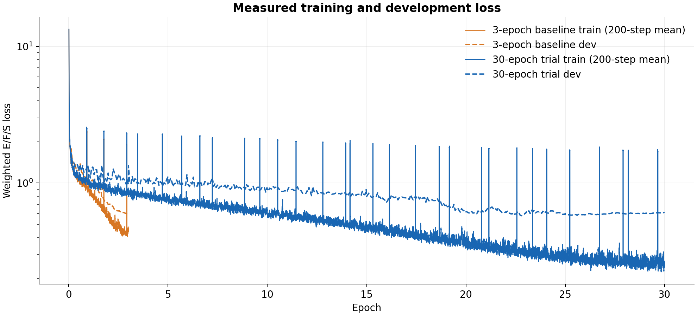

> Historical record. Current pretraining integration: [VALIDATION-pretraining.md](VALIDATION-pretraining.md).
> PR #90 subsequently evaluated historical baselines on test; statements below about an unused
> test panel or pending Harbor setup describe the earlier experiment, not current global status.

# Historical pretrained trials: 3 versus 30 epochs

**Track changed to from-scratch pretraining on 2026-10-01.** All full training
results below used pretrained UMA-S-1.1 and published MPA fitted offsets. They are
historical comparisons, not new-track baselines. The three physical evaluators and
frozen panels are unchanged, so physical metrics remain comparable. The historical
loss curves and timings do not establish convergence for the scratch recipe.
The new starter constructs random UMA-S weights and fits statistics on training
only. A full scratch pilot, training budget and reference scores remain pending.

Conversion checks passed: 35 CPU tests, the separate historical-correction test,
Ruff and diff checks. A CPU integration probe instantiated all 146,566,305 trainable
parameters without pretrained assets, verified seed-dependent initialization,
completed two finite-gradient optimizer steps on four synthetic training structures,
and exported/reloaded the checkpoint. Finite-difference checks passed on two
synthetic dev structures (maximum force/stress residuals 5.77e-6 eV/Å and
2.81e-7 eV/ų). This is an implementation check, not a DFT benchmark score or
convergence test. The probe used no final-test data and all its containers stopped.

**Historical adaptation recommendation: three epochs.** The longer run
improved some errors but gave mixed physical results at about **11× training time**.
This is one seed on custom validation panels, not a convergence or leaderboard claim.

## Training and checkpoint selection

- **Model:** original UMA-S-1.1 backbone + new conservative E/F/S head; both trained.
- **Data:** the same 500,000 MPTrj+sAlex training frames and 5,000 composition-disjoint labeled-dev frames.
- **Hardware/batch:** eight H100 80 GB GPUs; global batch 32, nominal four/rank with atom-balanced redistribution.
- **Optimizer:** AdamW, peak LR 4e-4, weight decay 1e-3; E/F/S weights 20/2/1; FP32, seed 41, EMA off.
- **Comparison:** fresh runs from the same initialization; cosine horizons of three and 30 epochs respectively.
- **Selection:** lowest labeled-dev loss among saved checkpoints. Physical metrics did not select the checkpoint.

| Setting | 3-epoch baseline | 30-epoch trial |
| --- | ---: | ---: |
| Completed | 2026-09-23 | 2026-09-30 |
| Optimizer updates | 46,875 | 468,750 |
| Labeled-dev evaluations | 49 | 495 |
| Selected step | 46,875 (epoch 3) | 400,000 (epoch 25.6) |
| Execution | One segment | Six five-epoch segments |

The long run restored optimizer, scheduler and progress across segments; all six
reached their exact cumulative update counts without checkpoint-persistence warnings.
FAIRChem does not persist RNG state here, so this is not a claim of bitwise identity
to an uninterrupted run. The lowest observed dev loss, 0.5767 at step 356,000, was
not saved; the lowest **saved** checkpoint won. Epoch 30 is a secondary diagnostic.

| Labeled-dev metric | Baseline: epoch 3 | Long: selected epoch 25.6 | Long: final epoch 30 |
| --- | ---: | ---: | ---: |
| Weighted E/F/S loss | 0.5963 | 0.5816 | 0.6105 |
| Energy MAE, meV/atom | 15.551 | 15.152 | 16.307 |
| Force MAE, meV/Å | 38.041 | 37.242 | 37.197 |
| Stress MAE, GPa | 0.3226 | 0.3332 | 0.3339 |

- Training lines are 200-step means across ranks; dev lines use full labeled-dev checks.
- The logarithmic plot uses all 46,875 / 468,750 updates and 49 / 495 dev checks.
- Training loss keeps falling while dev loss largely plateaus, with occasional finite spikes.
- [Original baseline curves](figures/loss-curves.png) include per-epoch E/F/S errors.

## Physical validation

Same frozen panel: **1,000 WBM discovery + 100 MDR phonons + 100 MP elasticity** cases.
All three checkpoints scored **1,200/1,200**. These are custom stratified subsets
with `leaderboard_comparable: false`; see [the protocol](PROTOCOLS.md).
The **6,000-case final test remains unevaluated**.

| Metric | Baseline: epoch 3 | Long: selected epoch 25.6 | Long: final epoch 30 |
| --- | ---: | ---: | ---: |
| Discovery F1 ↑ | 0.8563 | 0.8496 | 0.8571 |
| Discovery precision / recall ↑ | 0.8324 / 0.8817 | 0.8471 / 0.8521 | 0.8623 / 0.8521 |
| Hull-distance MAE, meV/atom ↓ | 20.448 | 19.735 | 19.809 |
| Unique-prototype F1 ↑ (837 cases) | 0.8906 | 0.8769 | 0.8837 |
| Unique-prototype hull MAE, meV/atom ↓ | 20.953 | 20.624 | 20.744 |
| Phonon maximum / mean frequency MAE, K ↓ | 53.682 / 19.767 | 49.686 / 22.128 | 45.594 / 20.499 |
| Entropy MAE, J/(mol primitive cell K) ↓ | 31.313 | 36.086 | 33.606 |
| Heat capacity MAE, J/(mol primitive cell K) ↓ | 12.912 | 12.383 | 11.531 |
| Free energy MAE, kJ/mol primitive cell ↓ | 12.923 | 14.761 | 13.665 |
| Bulk / shear VRH modulus MAE, GPa ↓ | 4.852 / 9.990 | 6.093 / 10.916 | 6.449 / 10.811 |
| Initial relaxations at step cap (included) | 4 | 6 | 6 |
| Strained relaxations at step cap | 0 | 0 | 0 |

- **Selected long checkpoint:** hull MAE improved 3.5% and maximum-frequency MAE 7.4%; discovery F1, mean-frequency error and elasticity worsened.
- **Final checkpoint:** stronger maximum-frequency result, but still mixed across suites; not substituted for dev-based selection.
- **Regression:** both selected models passed all 28 known-failure cases; diagnostic only.
- **Interpretation:** this trial does not justify a 30-epoch default. No significance claim.
- **Frozen v1 aggregate, added before the scratch trial:** 50.00 / 47.33 / 48.15 for the three columns above. This retrospective summary uses the four declared primary metrics; no new physical evaluation was run.

## Measured time

| Stage | 3-epoch baseline | 30-epoch trial |
| --- | ---: | ---: |
| Training process | **2 h 16 min 14 s** | **25 h 5 min 4 s** |
| GPU functions | 2 h 16 min 28 s | 25 h 8 min 54 s |
| H100-hours (eight × GPU-function duration) | 18.2 | 201.2 |
| Selected-checkpoint physical validation | **14 min 22 s** | **11 min 41 s** |
| Final-checkpoint physical validation | Same checkpoint | **10 min 57 s** |
| Selected-checkpoint regression | 1 min 32 s | 1 min 17 s |

- Training includes labeled-dev checks and persistence; long-run totals sum six segments, excluding queue gaps. H100-hours are not billing records.
- Initial source preparation took about 74 min, separately; both trials reused cached inputs. Peak allocated training memory was about 22.8 GB/GPU.
- Physical validation used eight H100 workers, including startup, prediction, assembly and scoring. Different allocations preclude a model-speedup claim.
- Final-checkpoint timing comes from the original completed call (657.403 s). A coordinator replay reused saved chunks and overwrote the summary with 234.784 s; both returned identical scores, configuration and case timings. The partial replay is excluded above.
- Summed physical case time was 1.47 / 1.23 / 1.24 worker-hours for baseline / selected / final; this includes CPU work while a GPU worker is reserved.
- Both run-owned Modal apps are stopped. The HF bundle now also preserves all four checkpoints and compact reproducibility records; raw container logs remain in operator storage.

## Evidence and limits

- Baseline run: `standard-500k-20260923-01`; long run: `long-30ep-500k-20260929-01`.
- The pinned [HF release](https://huggingface.co/datasets/junlinw/ai4sci-atomistic-materials/tree/1177b47d5c221602ec13216bf1dc3955ca9dc247) holds training data, split metadata, four model checkpoints, prepared evaluation panels and both trials' compact records, including curves, scores, predictions and the final-checkpoint timing audit. Raw segment logs remain in operator storage, outside Git.
- Training selection: 309,057 source-parent groups, 263,868 compositions, 11,624,621 atoms; median / p95 / maximum structure size 14 / 76 / 444 atoms. Full source scans: 1,580,395 MPTrj and 10,447,765 sAlex frames.
- The original UMA weights and three exported checkpoints are included in the public bundle under the FAIR Chemistry License and Acceptable Use Policy. Evaluation inputs and manifest hashes matched across all three evaluated checkpoints.

| SHA-256 evidence | Value |
| --- | --- |
| Original UMA checkpoint | `07068e9c76702ca173d13155095f2117c1b327ec228557e64cd2709c777b824a` |
| Baseline selected checkpoint | `e69e96f047dfc08373f2561b402503594e7a6a3b79516c1e1031c42fc1ac57cc` |
| Long selected checkpoint | `b11248359ca786d68c2f5f192ad5d9b53920ce7b517a179c667dd771069024ea` |
| Long final checkpoint | `31aacf867441c00b126182e95e92778a743ec8786ed9564d8a04497518e00c99` |
| Training manifest | `3137d03aaebad319004e9af39c8888314dd00264b806f4b957e264800bd3f166` |

Packaging checks: 34 CPU tests and the separate historical-correction test passed.
The original 15-file HF release and all 73 payloads in the expanded bundle were
anonymously downloaded and checksum verified, including all four checkpoints.
The four downloader tests passed, including explicit test selection and automatic
license notices; prepared validation/test/regression panels passed fresh/repeat
download and membership/hash checks. Fresh upstream preparation reproduced the 1,200-case
input, target and reference-manifest hashes exactly. The expanded HF bundle adds
models and prepared evaluation panels through explicit downloader components;
test data remain opt-in. Data, weights and bulky logs remain outside Git.

Public pretrained weights may have seen evaluation materials. Native Harbor
isolation and a final compute ceiling remain open. The measured
eight-worker Modal dispatcher is external to the portable task.
