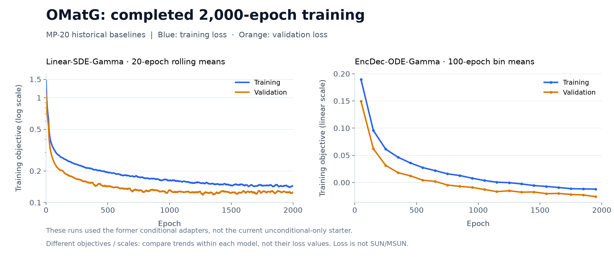

# CrystalGen validation evidence

Moved from the task root when the task adopted TASK_STANDARD.md. Paths below predate the move:
`/data/mp20` is now `/workspace/data/mp20`, `/scorer-assets` is mounted at
`/workspace/data/scorer-assets` (the old path remains as a link), `environment/starter` is now
`environment/baseline/starter`, and `environment/assets` moved to `environment/data/scorer_assets`
(documented in `environment/data/MATERIALIZE.md`). The operator variables `CRYSTALGEN_DATA_DIR`,
`CRYSTALGEN_SCORER_ASSETS_DIR` and `CRYSTALGEN_BENCHMARK_DIR` became `TASK_DATA_DIR` (with `mp20/`
and `scorer-assets/`) and `TASK_PRIVATE_DIR` (with `final-suite/`).

## Layout check after TASK_STANDARD.md (2026-09-27)

On one host with rebuilt images and the task's own compose files (`TASK_DATA_DIR` holding `mp20/`
and `scorer-assets/`, `TASK_PRIVATE_DIR` holding `final-suite/`), one H100:

- the development container started healthy with `train.csv`, `val.csv` and the manifest under
  `/workspace/data/mp20` (no `test.csv`) and the assets under `/workspace/data/scorer-assets`
  (`/scorer-assets`, `/root/.cache` and the LeMat cache links resolve through it);
- the smoke generator published into the image-layer `/workspace/submission` twice and its two
  CIFs validated; the OMatG starter ran a one-step fit on one GPU, published over the existing
  package twice (a leftover "output directory is not empty" guard was removed), and the relocated
  package generated 4 valid CIFs;
- development scoring (UMA-200 relaxation + LeMat, one worker) of those 4 structures wrote
  `reward.json` with `reward` 0.0 (validity 0.75);
- the verifier (`main` + `grader`, `--allow-small-suite`, a 4-sample suite) replayed the OMatG
  package, sealed the output and graded it in 18 min: `reward` 0.0, validity 0.25;
- 36 unit tests pass, including the new invalid-package test (reward 0 and the grader exits).

## Independent reproduction (task reviewers, 2026-09-19/20)

On one 8×H100 host with the development image and the task's own materializers: MP-20 counts
27,136 / 9,047 / 9,046 matched; scorer assets were prepared with an approved UMA account; the
OMatG starter trained 2,000 epochs from scratch on six H100s in 5.4 h; 2,500 structures from the
relocated package scored SUN + MetaSUN **0.208** after UMA-200 relaxation and exact LeMat scoring,
against 0.106 for the no-learning smoke generator. Two scorer defects found on the way were fixed
upstream in PR #26 (SUN/MetaSUN silently 0 on the read-only asset mount; all LeMat workers on one
GPU). Numbers and costs: `environment/baseline/starter/RESULTS.md`.

## Current task (v0.3)

Unconditional-only generation, 2,500 requested structures, fixed UMA-200
pre-scoring relaxation, then the unchanged pinned LeMat ensemble. The headline
is SUN + MetaSUN divided by all requested samples. This evaluates the complete
generator-plus-postprocessing pipeline, not raw-generator geometry alone.

- 33 local unit tests pass: request/package schemas, denominator accounting,
  read-only replay/sealing, scorer failures, relaxation ordering, fixed recipe,
  timeout fallback, missing assets, output hashes and development/final code identity.
- Canonical PIER task/config validation, Python syntax and YAML checks pass.
- Three saved candidates rerun through the new helper matched the experiment's
  convergence flags and final energies within 0.000054 eV. CIF bytes differed
  under floating-point GPU execution; this is numerical, not bitwise parity.
- The singleton smoke exposed an upstream Fréchet/LAPACK hang on undefined
  sample covariance. `lemat-small-batch.patch` rejects fewer than two valid
  samples as an unavailable diagnostic before covariance calculation; the
  tested two-sample path and all SUN/MetaSUN calculations remain unchanged.
- A bounded current-source Modal acceptance completed: one-step fit, export,
  relocated replay, sealing, and fixed relaxation plus exact scoring.
- Fresh Docker/Harbor + NVIDIA `network_mode: none` acceptance and a full new
  2,500-sample fresh-generation replay are not yet measured. The earlier Modal
  PIER smoke used host-networked Docker-in-Docker. Source checks and UID-demoted
  replay do not prove an independent network/mount boundary.

The current-source acceptance initially stopped at the existing asset-tree
integrity guard. A read-only audit found exactly four runtime-cache additions
(two Matplotlib font lists and two zero-byte dataset locks, 53,922 bytes total)
in the historical writable Modal volume. Excluding those four files reproduced
the original 225-file, 52,479,198,517-byte tree hash exactly; model/data bytes
were unchanged. Only those audited additions were moved recoverably to
`experiments/asset-audit-1789494163890659005/quarantined-runtime-cache/` before
retrying grading. The original `READY.json` and the integrity guard were not
changed. Production assets must remain read-only as declared in Compose.

### Completed current-source Modal smoke

[Successful grading run](https://modal.com/apps/modal-labs/junlin-dev/ap-R7AmHOOCBdpRmdKW3mJAIn),
completed September 15, 2026 at 18:20:52 UTC in `junlin-dev`.
Requested eight H100s; allocated hardware was eight H200s. This used current
source overlays on the pinned cached image, not a fresh Docker image build.

| Stage | Result | Wall time |
| --- | --- | ---: |
| Development relaxation helper | 3 saved CIFs relaxed/converged; 1 malformed CIF preserved | 2m01s |
| Current unconditional starter fit | 12,403,912 parameters; one train batch + one validation batch | 7m28s |
| Safetensors export | One portable checkpoint, trained from scratch | 3s |
| Relocated generation | UID-demoted frozen source; 4 outputs produced and sealed | 32s |
| Trusted relaxation + exact scoring | All 4 count; 1 valid/unique/novel; 0 SUN and 0 MetaSUN | 9m19s |

The final grader relaxed all four outputs: two converged, two retained finite
unconverged iterates, none fell back. Relaxation itself took 4m43s within the
9m19s grading stage. Fréchet distance was correctly unavailable for one valid
sample; headline metrics completed. The one-step model includes unsupported Es
chemistry and is a plumbing test, not a trained quality baseline. The same four
sealed outputs were reused across grading retries; no resampling or retraining.

Successful stage times total approximately 19m22s, excluding failed attempts
and diagnostic gaps. The first grading attempt stopped on the cache-only asset
drift above. After restoration, a retry was interrupted after 14m22s at the
undefined singleton Fréchet calculation; the narrow diagnostic guard resolved
it. A recreated zero-byte hull lock was also moved to the audit recovery
directory. Successful grading used the canonical cache aliases and redirected
Matplotlib's writable cache outside scorer assets; the original asset tree and
`READY.json` stayed unchanged.

Evidence in the `crystalgen-smoke` Modal volume:
`experiments/release-v03-20260915/STATUS.json`, stage logs, relocated package,
sealed output and guarded score artifacts. The local smoke workspace retains
`results/release-acceptance-complete-20260915.json`, the helper parity report and
the asset-integrity proof. The exported checkpoint SHA-256 is
`b611f1d74fb7cf45cb347f0e4b280da76587da2db7cf0eff1ac5a87a4af79d45`.
The guarded LeMat `distribution_utils.py` SHA-256 is
`303231ba8556572be12255e990041fd73f2063d15cf66d5a127be918d292791a`.

## Completed paired relaxation experiment

[Modal run](https://modal.com/apps/modal-labs/junlin-dev/ap-81Q1gvLaFbIUxSEwbtAc8x),
September 15, 2026; experiment `omatg-uma-relax-200-20260914`.
One successful attempt. Requested eight H100s; Modal allocated eight H200s.
The same 2,500 saved unconditional CIFs per 2,000-epoch checkpoint were reused;
no retraining, resampling, candidate selection or failure removal.

| Metric | Linear raw | Linear relaxed | EncDec raw | EncDec relaxed |
| --- | ---: | ---: | ---: | ---: |
| Requested | 2,500 | 2,500 | 2,500 | 2,500 |
| Loaded | 2,500 | 2,500 | 2,438 | 2,438 |
| Valid | 92.00% | 95.56% | 89.64% | 93.08% |
| Unique | 91.68% | 95.00% | 89.20% | 92.48% |
| Novel | 68.76% | 67.88% | 65.44% | 66.28% |
| Stable | 0.04% | 5.76% | 0.24% | 5.72% |
| Metastable | 13.16% | 39.60% | 16.92% | 36.84% |
| SUN | 0% | 0.64% (16) | 0% | 0.52% (13) |
| MetaSUN / MSUN | 1.88% (47) | 20.40% (510) | 2.64% (66) | 19.04% (476) |
| SUN + MetaSUN | 1.88% | **21.04%** | 2.64% | **19.56%** |

Recipe: frozen UMA `uma-s-1`, task `omat`, BFGSLineSearch + FrechetCellFilter,
atom positions and variable cell, `fmax=0.02` eV/Å, at most 200 steps and
300 seconds per candidate. Failed refinements preserve original bytes; finite
unconverged last iterates are retained. LeMat's separate 50-step diagnostics
remain unchanged. A malformed output is still a failed requested sample.

| Stage | Linear | EncDec |
| --- | ---: | ---: |
| Refined / converged | 2,489 / 2,476 | 2,429 / 2,415 |
| Finite unconverged / original fallback | 13 / 11 | 14 / 71 |
| Relaxation wall time | 46m45s | 46m23s |
| Exact rescoring wall time | 4h15m18s | 4h03m29s |
| Combined stage wall time | 5h02m03s | 4h49m52s |

Total sequential wall time: **9h52m15s**. Linear leads this single run by
1.48 percentage points after relaxation, reversing the raw-output ranking.
This does not establish a statistically robust architecture win or an official
leaderboard result. Both checkpoints were trained with the historical conditional
adapters; they are not measurements of the new unconditional-only starter.

### Reproducibility identifiers

- LeMat source: `58e6eae3e4a6c87c22171cf069123ecc4e2fa7e6`, plus the checked-in
  worker/cache patch. Global-batch metric code and normalization are unchanged.
- Requests SHA-256: `d5b4f950d16f1cfb0b384ff5819b579485f341be412c4bc93044c6e63a103f27`.
- Linear checkpoint: `824fa9ff0aba072a83aebf830aba7383c3b3b19764c2062d77b4393d1f99be82`.
- EncDec checkpoint: `4fd51a83bea80a61654a9dd44da3502386b4932c133d57c909a2807ca61da5ef`.
- Prepared asset tree: `0ee3713b61e506feb735f474e618c7c8d595c86e92abbab7044ffc683d008bd2`.
- Linear report: `ba6bcb10d8261cc95618755d995e53ca71b43a8af714f2f71a83ae5798b89e08`.
- EncDec report: `4c4b3e335b96845793d89fd0b3c8fdf0dae742b053b422d8231139bf58465e0f`.

Operator evidence is retained in the `crystalgen-smoke` Modal volume,
environment `junlin-dev`, under `experiments/omatg-uma-relax-200-20260914/`:
`STATUS.json`, `PREFLIGHT.json`, and each model's `samples/`, `generated/`,
`RELAXATION_READY.json`, `EVALUATION_READY.json` and `score/report.json`.
These paths are an experiment audit, not runtime dependencies of this task.

## Historical training and smoke tests (not the current recipe)

Blue is training loss; orange is held-out validation loss. Linear shows the
previously published trailing 20-epoch means on a log axis; EncDec shows
100-epoch bin means on a linear axis, including epochs 1,901–2,000. The two
models use different objectives, so their absolute losses are not comparable
and neither curve is a SUN/MetaSUN score. Both runs used the former conditional
adapters, not the current unconditional-only starter. Linear resume overlaps
follow the newer run.

Figure sources in the external smoke workspace are
`results/omatg-training-loss-complete-20260910.full.mmd` (SHA-256
`5e4bb1f62e53b2a5099d50b68c5c9ba50a2fb7483cd1eb677568d748b240a26d`)
and `results/encdec-loss-complete-20260914.json` (SHA-256
`d10468d1f211c017c828116359c7ed693348a4fb95ccd2d01f7675421bf6095b`).
The original numeric Mermaid curves remain in PR #7; the image adds a compact,
immediately visible comparison without changing the logged values.

The earlier PIER end-to-end smoke used 100 unconditional + 100 conditional
outputs per model. Its weak generator had 18% unconditional validity; the
400-epoch conditional OMatG reached 85%. Both scored 0 SUN/MetaSUN at that size.
The conditional track and its adapters are now removed. Historical one/eight
worker LeMat runs matched all six checked classification metrics; that result
does not claim bitwise CUDA relaxation reproducibility across hardware.

| Historical training milestone | Additional wall time | Cumulative |
| --- | ---: | ---: |
| Linear, 400-epoch budget | 1h14m58s | 1h14m58s |
| Continue selected epoch 398 → 1,000 | 1h41m12s | 2h56m10s |
| Continue selected epoch 967 → 2,000 | 2h52m10s | 5h48m20s |
| EncDec, scratch → 2,000 | 3h54m19s | 3h54m19s |

Training times include setup/validation/export, exclude image builds/downloads
and evaluation, on the recorded eight-H100 training runs. Continuations repeat
epochs after the selected checkpoint, so cumulative time is not a clean 2,000-
epoch throughput benchmark. No historical checkpoint initializes the new task.

| Historical evaluation | Generation | Scoring | Scope |
| --- | ---: | ---: | --- |
| 400-epoch raw original smoke | 1m10s | 26m57s | 100 U + 100 C |
| 400-epoch repaired confirmation | Reused | 1h42m49s | 500 U + 500 C |
| Linear 1,000 raw final comparison | 2m47s | 4h57m47s | 2,500 U; 1.52% MSUN, 0% SUN |
| Linear 2,000 raw paired comparison | 2m10s | 4h48m38s | 2,500 U |
| EncDec 2,000 raw paired comparison | 1m54s | 4h39m15s | 2,500 U |

September 10 attempts with missing UMA/hull assets or NaN novelty were excluded,
not counted as zero-quality results. They prompted the checked-in infrastructure
failure guards. The repaired replay verified all three models/hulls and
5,335,299 novelty-reference rows before scoring.

## Public comparison and research headroom

The [public MP-20 OMatG row](https://huggingface.co/spaces/LeMaterial/LeMat-GenBench)
shows 1.0% SUN + 18.0% MSUN = 19.0% (checked September 15, 2026), with
already-relaxed submitted structures. Our numbers use the same pinned metric
implementation but different weights, training, postprocessing and samples;
they are not a public submission or a controlled reproduction.

Relaxation explains a large portion of the raw-score gap. Remaining research
directions include improving strict stability without losing novelty, periodic
geometry representations, training-split curation/reweighting, optimization and
sampling. More data such as Alex-MP-20 is a separate future task-policy choice:
current rules permit only MP-20 train and forbid potential-output distillation.
There is no established ceiling from these single-run experiments.
