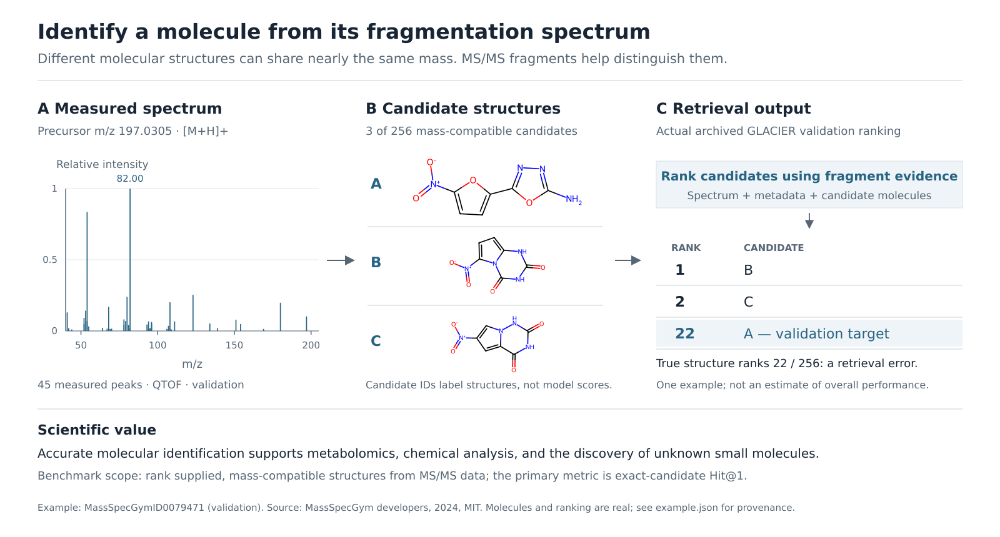

# Mass Spectrometry Molecule Retrieval

## 1. Overview

This Harbor task asks an agent to develop a model that identifies a molecule
from an experimental tandem mass spectrum by ranking a mass-filtered candidate
set. It uses the standard, formula-free retrieval challenge from MassSpecGym
v1.5 rather than combining retrieval, de novo generation, and spectrum
simulation into one ill-defined objective.

The primary metric is hit rate at 1. Hit rates at 5 and 20 and MCES distance at
1 are reported as secondary metrics. The evaluator replays the submitted model
on all 17,556 official test spectra and retains the full denominator.



The figure uses a real validation spectrum and a recorded GLACIER candidate
ranking; the shown target is ranked 22nd and is explicitly marked as a retrieval
error. It illustrates the scientific task rather than claiming perfect example
performance. See [figure provenance and editable sources](docs/figures/README.md).

**Why this task shape.**

- Spectrum-to-structure retrieval is directly useful for metabolite,
  environmental-contaminant, and small-molecule identification.
- MassSpecGym is a NeurIPS 2024 Datasets and Benchmarks benchmark with a
  structure-disjoint split and public evaluation definitions.
- The Fourier-feature DeepSets starter is small enough to train in minutes on
  one GPU. The formal target replays the published GLACIER forward simulator on
  its supported MassSpecGym conditions and uses the independently trained
  data-safe MIST pipeline on the remaining conditions.
- A fixed candidate-ranking contract makes independent replay practical and
  avoids judging an agent by a self-reported score.

**Method landscape.**

- **Fourier-DeepSets** is the task-owned fast starter: spectrum to Morgan
  fingerprint, followed by candidate fingerprint similarity.
- **GLACIER** is the main formal branch: a graph-transformer/DETR-style forward
  simulator scored against the observed spectrum. The public weight is the
  base, from-scratch model, not the paper's optional contrastively finetuned
  checkpoint and not a generic pretrained molecular model.
- **MIST-CF -> MIST** is the formal fallback outside GLACIER's published
  condition domain. Its independently trained clean top-five/max configuration
  reaches 39.872% Hit@1 as a standalone full-task method.
- **ICEBERG** is a strong forward-model route: simulate a spectrum for every
  candidate and rank by observed-versus-simulated agreement. It is a natural
  source of a hybrid reranker and does not require a true precursor formula.
- **SIRIUS/CSI:FingerID** is a classic database-search system and an important
  external scientific reference. It is not the starter because its full
  workflow, trained predictors, and service/data assumptions do not form a
  small from-scratch task-owned baseline.
- **MassFormer** is a forward molecule-to-spectrum graph transformer rather
  than an inverse retrieval model. Its most natural use here is candidate
  reranking by agreement between the observed spectrum and candidate-simulated
  spectra, potentially combined with an inverse encoder.

This separation keeps the benchmark contract method-neutral: fingerprint
prediction, contrastive retrieval, forward simulation, and hybrid pipelines all
produce the same complete candidate ranking.

**Status.** The integrator reproduced both baselines through the isolated verifier: DeepSets exactly (4.004 % Hit@1) and
native GLACIER from scratch over eight seeds (40.45 ± 0.36 %, against the author's 40.32 %). The workspace follows
[TASK_STANDARD.md](../TASK_STANDARD.md).

## 2. Data

The default operator helper downloads an already-materialized, checksum-verified
release from `Corning/ai4sci-massspecgym-retrieval`, with grader labels fetched
separately from the private `Corning/ai4sci-massspecgym-retrieval-evaluation`
repository. Both revisions are pinned in `environment/data/hf_release.json`.
No source preprocessing or MAGMa preparation is needed for this path.

The optional source rebuild starts from two files in the MIT-licensed Hugging Face dataset
`roman-bushuiev/MassSpecGym` at a pinned full revision:

- `MassSpecGym1.5.tsv` (231,104 experimental spectra), and
- `MassSpecGym1.5_retrieval_candidates_mass.json` (at most 256 candidates per
  molecule, selected by precursor-mass compatibility).

To keep the comparison fair, the development mount also includes the
MIT-licensed ICEBERG augmentation used by the strong reference. A task-owned
sanitation pass removes 15 held-out-structure rows and 10 RDKit-invalid rows,
leaving 2,333,485 simulated training examples in a lossless SQLite store. An
agent may ignore this corpus, but it is not asked to beat an inaccessible-data
baseline.

The official folds contain 194,119 train, 19,429 validation, and 17,556 test
spectra, representing 22,746, 3,185, and 2,998 unique 2D molecular structures.
There is no molecule overlap between folds. The upstream paper constructed the
split so that structures in different folds have MCES distance at least 10.

| Resource | Size | Permitted use |
| --- | ---: | --- |
| Experimental train | 194,119 spectra | Parameter fitting |
| Experimental validation | 19,429 spectra | Selection and diagnostics; no parameter fitting |
| Experimental test | 17,556 spectra | Independent frozen-model evaluation only |
| Optional clean ICEBERG augmentation | 2,333,485 simulations | Parameter fitting; equally available to all agents |
| Prepared MAGMa supervision | 99,119 train / 9,720 validation rows | Native training / checkpoint selection, respectively; no test supervision |

The MAGMa preparation starts from 99,341 / 9,734 eligible train / validation
spectra and excludes 222 / 14 with no assigned fragment. These training-target
exclusions never shrink retrieval validation or test coverage. The native
baseline below uses the prepared MAGMa train view plus experimental-only
DeepSets training; the optional synthetic corpus is used by the MIST reference
and is available for agent improvements.

The materializer removes test structures and labels from the development view.
It also converts the upstream answer-keyed candidate dictionary into anonymous,
deterministically ordered candidate pools. The verifier receives spectra,
candidate IDs, and candidate SMILES; the grader alone receives the correct
candidate IDs and structures.

MassSpecGym is public, so this isolation prevents accidental leakage during a
run but does not make the upstream benchmark cryptographically blind. Models
must not train on or encode the official validation or test answers.

See [data/README.md](environment/data/README.md) for the pinned files, checksums,
prepared layout, and materialization command.

Controller commands: [`environment/data/MATERIALIZE.md`](environment/data/MATERIALIZE.md). What the agent sees:
[`environment/data/README.md`](environment/data/README.md).

## 3. Workspace

| path | contents |
| --- | --- |
| `/workspace/instruction.md`, `/workspace/contract.md` | the prompt; the package, ranking interface, replay limits, metrics, reward |
| `/workspace/data/` | `README.md`, `check_resources.py`; the development view (train, validation, candidate pools, `glacier/`, `synthetic_augmentation/`) as read-only mounts |
| `/workspace/baseline/starter/` | Fourier-DeepSets (**4.00 %** Hit@1) and `glacier/`, native GLACIER from scratch (**40.45 %**); `RESULTS.md` |
| `/workspace/references/` | the official-weight GLACIER/MIST target (49.39 %), SOTA and protocol audits, the author's reproduction scripts |
| `/workspace/evaluation/` | validation staging, scoring, diagnostics, paired bootstrap |
| `/workspace/submission/`, `/workspace/research/` | the current package (versioned, atomic), and writable scratch on a large disk |

## 4. Evaluation

**Reward.**

The canonical Harbor reward is `{"reward": P}`, the raw full-test Hit@1. For
context, the repaired Fourier-DeepSets acceptance replay reaches
P = 0.04004329004329004 and the strongest reproduced full-test GLACIER + clean
MIST reference P = 0.4939052175894281 (a reproduced reference, not a theoretical
optimum). `report.json` keeps Hit@1/5/20, MCES@1 and, as a diagnostic only, the
earlier reference-normalized score from `environment/evaluation/score_bounds.json`.
The independently trained scratch GLACIER + DeepSets baseline remains a
separate result; do not confuse it with the official-weight reference, and the
reference does not authorize pretrained weights for agents.
Invalid submissions receive reward 0. Infrastructure/setup/scorer failures do
not produce a reward.

**Starter and reference baseline.**

The runnable starter is a compact reproduction of the official **DeepSets +
Fourier features** retrieval baseline:

1. retain up to 60 peaks between 10 and 1,000 m/z and add the precursor token;
2. Fourier-encode m/z and embed intensity;
3. aggregate peak embeddings with a DeepSets sum encoder;
4. regress a radius-2, 4,096-bit Morgan fingerprint using cosine loss; and
5. rank candidate Morgan fingerprints by cosine similarity.

The original MassSpecGym paper reported 5.24%, 12.58%, and 28.21% hit rate at
1, 5, and 20 for this method, with MCES@1 of 22.13. It remains useful for fast
contract validation, but it is not the target an agent is asked to beat.

See [baseline/starter/README.md](environment/baseline/starter/README.md) for the runnable baseline
and [the native research recipe](environment/baseline/starter/glacier/README.md) for the
full 15.1M-parameter GLACIER architecture, prepared MAGMa supervision, scratch
training, recovery and portable hybrid publication. Source and
pinned native runtime are provided in both development and verifier images.

The formal scientific reference is **GLACIER no-CF with a strict-clean MIST
fallback**. GLACIER uses a five-layer Graphormer and 200 object queries to
simulate a condition-specific spectrum for every candidate, then ranks by
entropy distance to the observation. Its public checkpoint covers the exact
9,954-query `[M+H]+`/known-energy/Orbitrap-or-QTOF test domain. The clean MIST
pipeline ranks the other 7,602 queries: its encoder was independently trained,
while MIST-CF formula prediction and fast filtering use released train-fold
weights. The exact full-denominator replay is:

| Metric | Reference value |
| --- | ---: |
| Hit rate @ 1 | **49.391%** |
| Hit rate @ 5 | 64.189% |
| Hit rate @ 20 | 74.436% |
| MCES @ 1 | 12.179 |

Thus the primary task objective is `hit_rate_at_1 > 0.4939052175894281` over the
full test denominator. The GLACIER paper reports 69.69% Hit@1 for the replayed
base model and 69.95% with contrastive finetuning, but only on its published
9,954-query condition domain and under its identity convention. Those numbers
are provenance checks, not substitutes for this task's exact-candidate,
17,556-query score. The former strict-clean MIST reference remains fully
documented and supplies the domain-safe fallback.

See [references/README.md](environment/references/README.md) for immutable source
pins, the training recipe, confidence intervals, leakage gates, and the exact
meaning of “beat.”

The verifier stages the test queries without labels and replays `infer.sh` as uid 10001 with no network. A separate
CPU-only grader, the only service that mounts the labels (`TASK_PRIVATE_DIR`), writes `/logs/verifier/reward.json`
(`reward`, Hit@1) and `report.json` (Hit@1/5/20, MCES@1, the normalized score as a diagnostic).

## 5. Running

```bash
export TASK_DATA_DIR=/large-disk/massspecgym-public TASK_PRIVATE_DIR=/protected-disk/massspecgym-labels   # section 2
export TASK_RESEARCH_DIR=/large-disk/runs/massspecgym-$(date +%s); mkdir -p "$TASK_RESEARCH_DIR"
harbor trial start -p mass-spectrometry-molecule-retrieval -a <agent> -m <model> --allow-agent-host <model API host>
```

**Compute and delivery (external budget).**

The agent budget is 48 hours on up to eight H100 GPUs, at least 64 CPU cores, 512
GiB of host memory and 1 TiB of disk. The formal GLACIER component replays an official checkpoint;
the separate task-owned result above retrains GLACIER from scratch. The
official-weight hybrid's complete construction replay used about
33.1 aggregate P100 GPU-hours, including retained partial work and
recovery; that official-weight hybrid's single-H100 verifier timing remains
unmeasured. The separate scratch-model reviewer timing is below. MIST-CF
training was reported at about seven hours on one H100. The task-owned
150-epoch MIST vFRIGID fallback training took 18 hours 54 minutes on one RTX PRO
6000 Max-Q after its leakage-filtered synthetic data had been generated. The
larger task budget is
intended for serious improvements such as stronger set/transformer encoders,
spectrum-molecule contrastive learning, learned candidate encoders,
simulation-aware reranking, ensembles, or carefully controlled pretraining.

The task-owned scratch run charged 20,988.441 seconds (5 h 50 min) to native
GLACIER training on one H200; its DeepSets fallback completed 50 epochs in
504.792 seconds. Full test predictions used four CS A5000s with original batch
composition preserved. A serial CPU ranking timeout was recovered from the
closed prediction files with 16 CPU workers; final ranking and grading took
488.090 seconds. This measures the frozen model's full test score, not the
unchanged single-H100 submission's five-hour deadline or a matched-budget
agent comparison. Failed and superseded attempts remain in the release ledger.

An independent [PR 27 reviewer replay](https://github.com/T0-RSI/ai4sci-tasks/pull/27#issuecomment-5750791449)
reports **3.4–3.9 hours for all 17,556 queries on one H100** with native
inference batch 64, compared with about five hours at batch 8. New native
publications therefore default to batch 64 and retain two inference workers;
training batch size remains 8. The publication CLI accepts
`--inference-batch-size` for a smaller positive integer on memory-constrained
GPUs. This reviewer timing supports the inference setting; current native
Docker/HF deployment acceptance remains separate. Historical scores, model
weights, data, routing and normalization anchors are unchanged.

The continuously usable artifact is `/workspace/submission`. The verifier moves
it into a fresh, offline environment and invokes:

```bash
bash infer.sh INPUT_ROOT OUTPUT_ROOT
```

See [contract.md](environment/contract.md) for the exact package, input, and
ranking schemas, and [evaluation/README.md](environment/evaluation/README.md)
for metric and failure semantics.


Agent-run protocol notes: [`docs/AGENT_EVALUATION.md`](docs/AGENT_EVALUATION.md).

## 6. Results and validation

**Task-owned baseline and SOTA context (task author).**

The **scratch GLACIER + DeepSets** reference completed training, full validation
and full test scoring on 2026-09-13. All 17,556 test rankings are valid; the
model has no missing supported candidate predictions. Both components start
from random weights. GLACIER uses the supplied 15.1M-parameter architecture and
train-only MAGMa targets, with checkpoint selection on validation spectrum loss.
DeepSets trains on the complete experimental train fold and selects on
validation fingerprint loss. Neither component uses the synthetic augmentation
in this run. Agent research may change these choices using validation feedback.

| Full-test method | Hit@1 | Hit@5 | Hit@20 | MCES@1 (lower is better) |
| --- | ---: | ---: | ---: | ---: |
| Official GLACIER no-CF + clean MIST, frozen external target | **49.390522%** | 64.188881% | 74.436090% | 12.178913 |
| Scratch GLACIER + clean MIST, cached prediction evaluation | **48.285486%** | 64.057872% | 74.561404% | 12.327666 |
| Scratch GLACIER + DeepSets, task-owned baseline | **40.322397%** | 56.846662% | 70.773525% | 13.169600 |
| Repaired DeepSets starter, current acceptance run | 4.004329% | 12.354751% | 27.403737% | 22.559581 |

The scratch hybrid's validation Hit@1 is **35.987441%** over 19,429 spectra.
On the 9,954-query GLACIER test domain, its Hit@1 is 65.541491%, compared with
67.490456% using official weights. On the remaining 7,602 queries, DeepSets
obtains 7.300710%, compared with MIST's 25.690608%. The fallback contributes
7.963090 of the 9.068125 percentage-point full-score gap (87.81%). Architecture,
training data and training schedule change together; this is a branch-level
decomposition, not a causal attribution to initialization.

**Supplemental evaluation, 2026-09-19 UTC:** combining the frozen scratch
GLACIER predictions with the existing clean MIST fallback gives **48.285486%
Hit@1** over all 17,556 test queries, an increase of **7.963090 percentage
points** over the DeepSets fallback. The remaining gap to the formal reference
is **1.105035 points**. The fixed 9,954/7,602 routing and all component rankings
were checked before trusted rescoring. Integrity checks, merging and full
scoring took **188.47 seconds** with 16 CPU MCES workers and no GPU; Hit@k was
available after 13.64 seconds. These timings exclude the historical training
and prediction runs. This reuses cached predictions and released MIST-CF
formula-stage weights; it is a post hoc comparison, not a new end-to-end
inference run or an entirely from-scratch pipeline. See the
[evaluation record](environment/references/scratch_glacier_clean_mist.json).

**SOTA check, 2026-09-13:** GLACIER + contrastive finetuning reports **69.95%**
on its released simulator-domain mass challenge (69.69% without finetuning).
This is the strongest published forward-model result located for that domain,
not a full-test v1.5 score. The higher **84.695% SpecBridge** headline is
excluded: [the author withdrew it on 2026-03-03](https://arxiv.org/abs/2601.17204v3)
because of a preprocessing/evaluation problem. GLMR's non-withdrawn 64.172%
mass-retrieval claim, FLARE, MSAlign, formula-known scores and newer external
evaluations are separately assessed in the
[SOTA audit](environment/references/SOTA_AUDIT.md). No complete current community
leaderboard under our exact v1.5 contract was established; 49.390522% is our
strongest reproduced reference, not a universal SOTA claim.

Exact metrics, data/weight/ranking hashes and the execution scope are recorded
in [task_trained_baseline.json](environment/references/task_trained_baseline.json).
The paper-score comparison does not change the task target or authorize
pretrained weights for agents.

Integrator reproductions: `environment/baseline/starter/RESULTS.md`. Readiness checklist and release acceptance:
[`docs/VALIDATION.md`](docs/VALIDATION.md), [`docs/BENCHMARK_READINESS.md`](docs/BENCHMARK_READINESS.md).

## 7. Limitations

The frozen task score uses only MassSpecGym v1.5. Adding another dataset to the
grader would mix candidate-library construction, instrument domains, licenses,
and often a formula-known setting into the optimization target. The official
structure-disjoint validation/test split is sufficient to decide whether an
agent improved this task.

For a broader scientific claim, evaluate the selected checkpoint without
test-set tuning on at least one external collection such as NPLIB1 or CASMI,
and report each dataset under its own candidate-set and formula-availability
contract. That is a transfer study, not a hidden benchmark component.

The expected contribution is one generally usable spectrum-to-structure
retrieval model, not one model per test query and not a universal molecular
foundation model. Architectures that transfer across instruments, adducts, and
candidate libraries are encouraged, but impact is established first by a
reproducible improvement over the strong fixed reference.

## 8. Citation and licenses

Upstream licenses: [`docs/UPSTREAM_LICENSES.md`](docs/UPSTREAM_LICENSES.md).

- Bushuiev et al., [*MassSpecGym: A benchmark for the discovery and
  identification of molecules*](https://proceedings.neurips.cc/paper_files/paper/2024/hash/c6c31413d5c53b7d1c343c1498734b0f-Abstract-Datasets_and_Benchmarks_Track.html),
  NeurIPS 2024 Datasets and Benchmarks.
- Wang et al., [*GLACIER: Rethinking Mass Spectrum Prediction as an Object
  Detection Problem*](https://arxiv.org/abs/2606.29161), 2026.
- Liu et al., [*MassSpecGym in the Wild: Uncovering and Correcting Evaluation
  Pitfalls in AI-Driven Molecule Discovery*](https://openreview.net/forum?id=I1PUDXXYot),
  2026.
- Zaheer et al., [*Deep Sets*](https://proceedings.neurips.cc/paper_files/paper/2017/hash/f22e4747da1aa27e363d86d40ff442fe-Abstract.html),
  NeurIPS 2017.
- Goldman et al., [*Annotating metabolite mass spectra with domain-inspired
  chemical formula transformers*](https://www.nature.com/articles/s42256-023-00708-3),
  Nature Machine Intelligence 2023.
- Goldman et al., [*MIST-CF: Chemical Formula Inference from Tandem Mass
  Spectra*](https://doi.org/10.1021/acs.jcim.3c01082), Journal of Chemical
  Information and Modeling 2024.
- Wang et al., [*Neural Spectral Prediction for Structure Elucidation with
  Tandem Mass Spectrometry*](https://www.biorxiv.org/content/10.1101/2025.05.28.656653v1)
  (ICEBERG).
- Young et al., [*Tandem mass spectrum prediction for small molecules using
  graph transformers*](https://www.nature.com/articles/s42256-024-00816-8),
  Nature Machine Intelligence 2024.
- Dührkop et al., [*SIRIUS 4: a rapid tool for turning tandem mass spectra into
  metabolite structure information*](https://www.nature.com/articles/s41592-019-0344-8),
  Nature Methods 2019.

MassSpecGym code and data are distributed under the MIT license. Preserve the
upstream attribution when publishing results or derived task assets.

