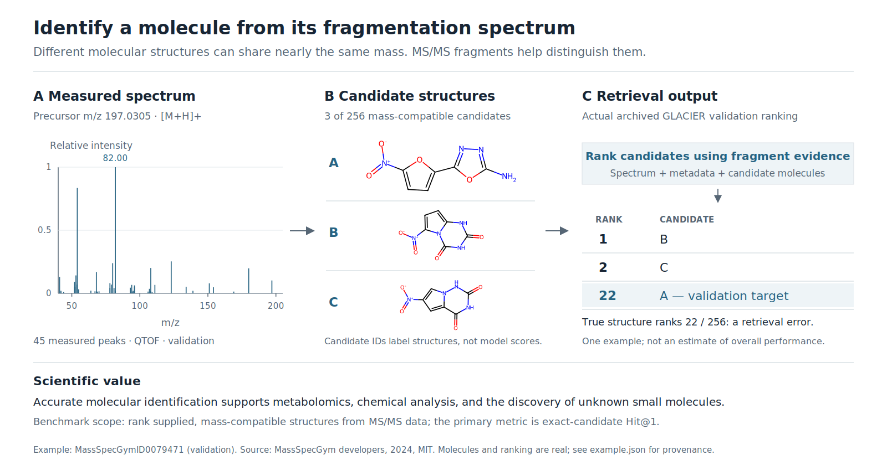

# Science introduction figure



The figure uses **real public validation data**: query
`MassSpecGymID0079471`, its 45 materialized MS/MS peaks, and three structures
from its 256-candidate, mass-compatible pool. The actual archived official
GLACIER no-CF validation replay ranks candidate B first, C second, and the
correct target A **22nd**. This deliberately retains the observed retrieval
error; the diagram makes no benchmark-wide performance claim. The example
was chosen for a small, legible molecule and available validation prediction,
before inspecting its target rank. No test query, test label, or model weight
is included.

Source: [MassSpecGym](https://huggingface.co/datasets/roman-bushuiev/MassSpecGym),
revision `d2e86d0c3bd905a6d578c0dd6053ed2bd41f9c2a`, MIT;
Copyright (c) 2024 MassSpecGym developers. The source license is retained in
[UPSTREAM_LICENSES.md](../UPSTREAM_LICENSES.md). The figure redraws spectrum
peaks and RDKit molecular graphs from the source records.

Files:

- `science-introduction.svg`: editable text and molecular vectors, 1600 × 860.
- `science-introduction.png` and `.pdf`: rendered exports.
- `example.json`: spectrum, displayed candidates, observed ranks, and provenance.
- `generate.py`: reproducible plot and RDKit structure drawing.
- `extract_example.py`: extraction from development data and archived rankings.

Regenerate from the committed example without downloading the full dataset:

```bash
uv run --with cairosvg==2.8.2 --with rdkit==2023.9.6 \
  python docs/figures/generate.py
```

Run from the task directory. The RDKit pin reproduces the original molecule
layout; use Python 3.10 or 3.11 for that wheel. To audit against source artifacts:

```bash
python docs/figures/extract_example.py /path/to/public/development \
  /path/to/glacier_full_validation/scored_entropy_all/rankings.jsonl \
  --output /tmp/massspec-science-example.json
cmp docs/figures/example.json /tmp/massspec-science-example.json
```

`example.json` records exact query/pool/ranking line hashes and the complete
archived validation-ranking file hash. The latter agrees with the validation
replay recorded in `environment/references/reference_baseline.json`. The
source development-file digests are copied from its materialization manifest.
The target is shown only to explain the observed outcome, not as a retrieval
input. The figure does not depict de novo molecule generation.

Rendering was checked visually at the exported PNG resolution. SVG text
remains selectable; molecular bonds and atom labels are editable vector paths.
