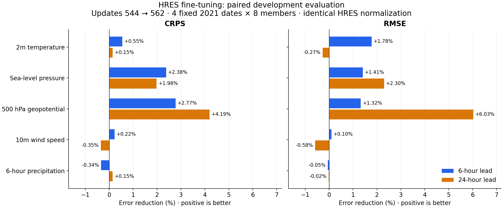

# Paired development checkpoint comparison

This diagnostic prioritizes evidence of improvement during seed 0's HRES fine-tuning. It compares weights at update 544 (before the 18 HRES updates) with final weights at update 562, on the same four pre-existing 2021 development dates. It is separate from the eight-date 2022 test comparison.

Both checkpoints use the **same final HRES inference configuration and training-only HRES normalization**. The first checkpoint is therefore the weight state at the start of HRES fine-tuning, not the original ERA5-stage predictor with ERA5 normalization. This holds preprocessing fixed to examine the effect of the subsequent weight updates. Both checkpoints have the same parameter tree and shapes, 0.25° grid and six-hour cadence.

The frozen plan uses eight ensemble members with identical timestamp/member/lead RNG keys. It scores 6-hour and 24-hour leads for 2m temperature, mean sea-level pressure, 500 hPa geopotential, 10m wind speed and six-hour precipitation ending at each lead. Forecast inputs contain context only; truth is read separately by the scorer. These dates and fields were selected before observing the comparison scores.

The report requires a completed forecast from both checkpoints before including a date. It retains per-date CRPS and MSE, then computes equal-date mean CRPS and the square root of mean MSE. Improvement is `100 * (1 - final / before)`; negative values are deterioration. The number of dates with lower error accompanies each aggregate. No significance or full-training convergence claim is made from four development dates.

`plan.json` binds the source weights, training reports, inputs, statistics and archived execution scripts by SHA-256. The archived scoring source includes the pinned `wn2/evaluate.py` implementation identified by the plan. Run `score.py` alongside that frozen evaluator with the pinned WeatherBench-X checkout on `PYTHONPATH`. It can report partial paired results while inference continues; the full result requires all four dates.

The score aggregation passed an analytical check: constant ensembles with error reduced from 2 to 1 yield exactly 50% CRPS and RMSE improvement for all fields and both leads. A missing checkpoint pair is excluded and the result remains partial. This checks the reporting calculation, not model skill.

## Results

**All four paired development dates completed.** The diagnostic ran in 18 minutes 51 seconds. The clearest 24-hour improvements are in 500 hPa geopotential and sea-level pressure. Temperature and precipitation are approximately unchanged, while 10m wind speed is slightly worse at 24 hours. These are descriptive results from four dates, not a significance claim.

| 24-hour forecast variable | CRPS reduction | RMSE reduction | Dates with lower CRPS | Dates with lower MSE |
|---|---:|---:|---:|---:|
| 2m temperature | +0.15% | -0.27% | 2/4 | 3/4 |
| Sea-level pressure | +1.98% | +2.30% | 3/4 | 4/4 |
| 500 hPa geopotential | +4.19% | +6.03% | 3/4 | 4/4 |
| 10m wind speed | -0.35% | -0.58% | 1/4 | 1/4 |
| 6-hour precipitation ending at hour 24 | +0.15% | -0.02% | 2/4 | 2/4 |

Positive percentages mean lower error; negative percentages mean deterioration. All five preselected variables are shown. At 24 hours, geopotential RMSE falls from 539.48 to 506.95 m²/s², and sea-level-pressure RMSE from 532.84 to 520.61 Pa. Their MSE improves on all four dates. Temperature RMSE changes from 2.0250 to 2.0304 K; wind-speed RMSE changes from 2.6033 to 2.6185 m/s.

Meeting takeaway: **Under a fixed HRES inference setup, the final 18 training updates improve short-range pressure and upper-air circulation predictions on four development dates, with mixed results for surface variables.** This does not prove continuous improvement throughout training or superiority over GenCast.

Download the [presentation figure (PDF)](improvement.pdf), [all summary metrics (CSV)](summary.csv), or [paired per-date scores and source identities](scores.json). Every forecast receipt and array hash, checkpoint/input binding, and scorer source identity was checked before publication.
