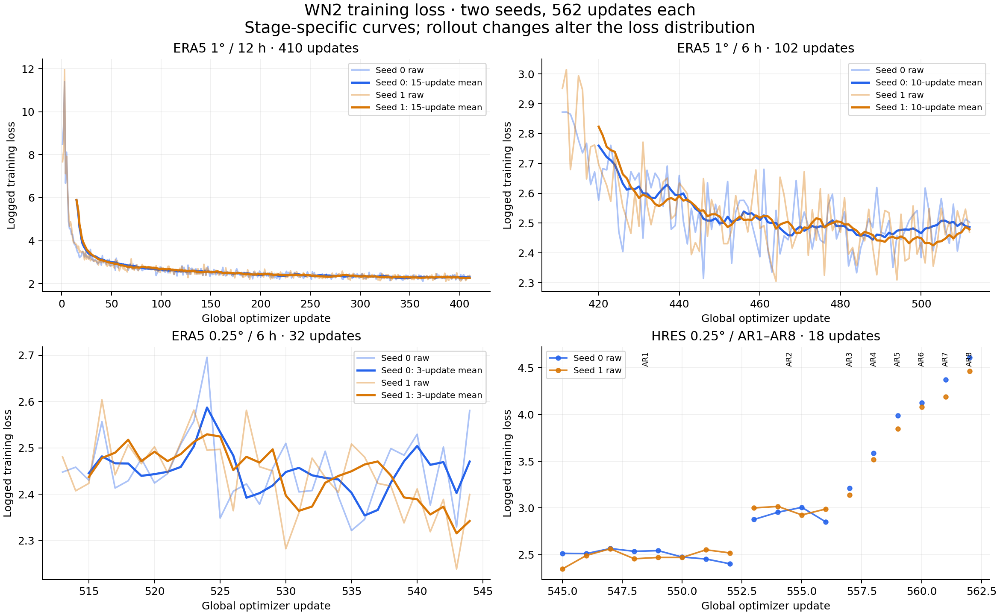
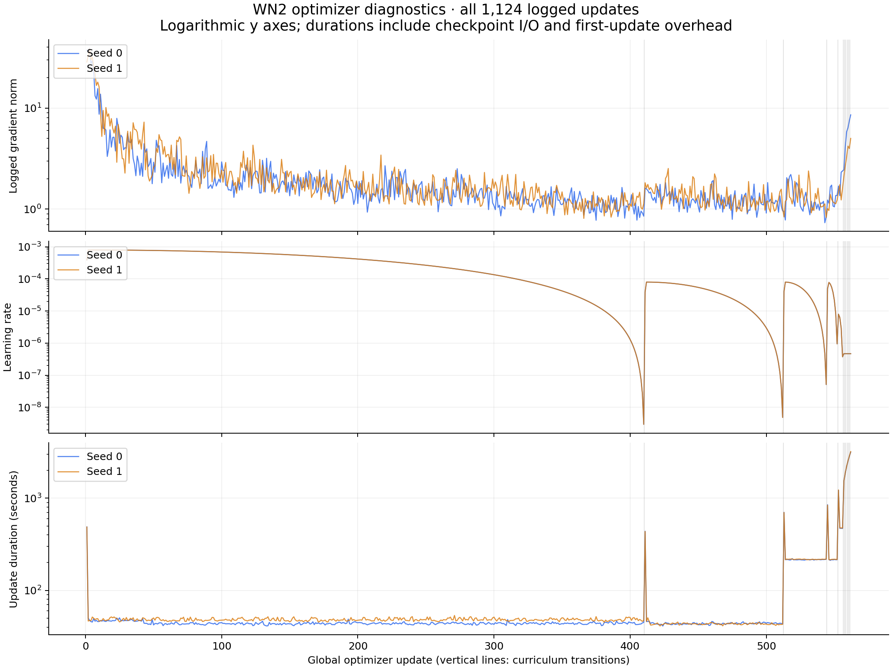

# Final WN2 training curves

Both seeds completed the same shortened curriculum: 11 stages and 562 optimizer updates each, with four RTX PRO 6000 GPUs and effective batch 64. Training orchestration took 14.86 hours (seed 0) and 15.36 hours (seed 1), excluding earlier profiling, packaging and evaluation.



Thin lines show every logged training loss. Thick lines are trailing arithmetic means computed within each stage only (15, 10 and 3 updates in the three ERA5 panels). HRES stages show raw points, connected only within a stage; AR3–AR8 each have one update. Panel y-axis ranges differ to expose within-stage behavior.

In the initial ERA5 stage, the first versus last 20-update mean loss falls from **5.254 to 2.303** for seed 0 and **5.313 to 2.274** for seed 1. Higher-resolution losses fluctuate; the abbreviated final stages do not establish convergence. Resolution, cadence, source data and autoregressive horizon change across the curriculum, so losses across stages are not directly comparable. These are training objectives, not held-out forecast scores or evidence of final evaluation acceptance.



All diagnostic y axes are logarithmic. Vertical lines mark curriculum transitions. Duration is the report's per-update `seconds`, including checkpoint I/O and first-update overhead; it is not pure GPU compute time or full orchestration time. Gradient norms and learning rates are the values logged by the training runner.

## Reproducibility

`updates.csv` contains all 1,124 updates without smoothing or downsampling. `sources.json` identifies the 22 source reports and their SHA-256 hashes, checked against `../wn2-seed-{0,1}-final-training.json`. Export checks require passed non-profile reports, the expected stage lengths, consecutive global updates 1–562 per seed and finite plotted values.

Recreate figures from the committed CSV (Python with NumPy and Matplotlib):

```sh
python3 probabilistic-global-weather/docs/validation/training-curves/plot.py
```

To re-export from the archived paired pipeline, add `--run-root /path/to/paired-pipeline-20260909`. No model weights, forecast arrays or training examples are included here.
