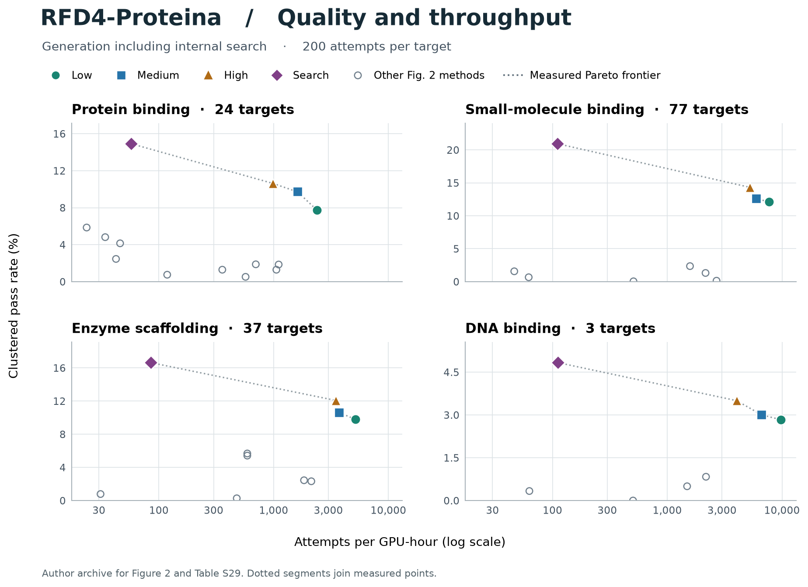

# RFD4-Proteina inference search

## 1. Overview

Develop **one unified inference-time search or sampling strategy** (`infer.py`) for frozen RFD4-Proteina that strictly advances the **quality-cost Pareto frontier** across **all four official Figure 2 biomolecular design tracks** (`Protein binding`, `Small-molecule binding`, `Enzyme scaffolding`, and `DNA binding`), evaluated against the RFD4 baseline family (`Low`, `Medium`, `High`, and `Search`).

**Independent Figure 2 baselines now cover 10 of 16 official settings locally on RTX A6000 (all 4 `Low`, all 4 `Medium`, `Enzyme scaffolding High`, and `DNA binding High` — 64,400 completed attempts across 322 target cohorts), with the final 25 `High` cohorts (`Protein High` 18/24, `Small-molecule High` 58/77) actively completing in parallel.** Completed RTX A6000 runs (`rfd4-a6000-warm-v1`) closely match the paper across every track: `Protein binding` (`Low 8.88% vs 7.73%`, `Medium 10.02% vs 9.71%`), `Small-molecule binding` (`Low 13.05% vs 12.12%`, `Medium 13.32% vs 12.58%`), `Enzyme scaffolding` (`Low 10.18% vs 9.78%`, `Medium 10.35% vs 10.61%`, `High 11.84% vs 12.07%`), and `DNA binding` (`Low 2.50%`, `Medium 2.00%`, `High 2.83%`). All 16 `Low / Medium / High / Search` reference coordinates, per-target tables, and reproduction logs are packaged into the agent workspace under `environment/references/overall/measured/`. [Consolidated frontier table](environment/references/overall/measured/baseline_frontier_reference.csv) · [Local four-panel plot](environment/references/overall/measured/generation.png) · [Local vs paper table](environment/references/overall/measured/comparison_vs_paper.csv) · [Per-target breakdown](environment/references/overall/measured/logs/per_target_comparison.csv) · [Coverage JSON](environment/references/overall/measured/coverage.json) · [Reproduction status & checklist](docs/FIGURE2_REPRODUCTION_GAPS.md)

Official Harbor scoring (`tests/test.sh`) and agent self-evaluation both run [evaluate_tracks.py](environment/evaluation/evaluate_tracks.py) across all four functional suites (`ppi_backbone`, `studio_figure_2c_unfixed`, `mcsa_fixed`, `dna_unfixed`), pairing the submitted `infer.py` package directly against same-GPU executable human baselines (`native-low`, `native-medium`, `native-high`) under identical per-request subprocess and persistent-AF3 timing boundaries (`rfd4-paired-program-v1`), matched attempt counts, and strict Pareto advancement criteria. [Official metrics and reference curves](environment/references/overall/README.md) · [Three-budget scorecard](environment/references/overall/BUDGET_CURVE.md) · [Task metadata](task.toml)



The repository also retains auxiliary unconditional monomer evaluation (`evaluation/run.py`), a multi-seed Table S15 sampler and recycling study, a 3-length comparison with the official AF3-guided monomer beam, an independent Table S16 SAM hydrogen-bond search reproduction, and the Table S28 audit. [DNA-binding runs](environment/references/dna_binding/README.md) · [Monomer beam & scaling](environment/references/monomer_beam/README.md) · [Table S16 H-bond search](environment/references/s16/README.md) · [Paper reproduction overview and commands](docs/REPRODUCE.md) · [Acceptance log](docs/ACCEPTANCE.md)

## 2. Data

From the repository root, run `runner/prepare.sh rfd4-inference-search /data/rfd4`. The materializer verifies SHA-256 digests for the RFD4 checkpoint (NVIDIA revision `a06e2509c7033b010fc43614e9fd840303588502`), **all 141 official Figure 2 conditioned benchmark `.cif.zst` inputs across all four tracks** (`24` PPI, `77` small-molecule, `37` enzyme/MCSA, `3` DNA, `2.07 MB` total from RosettaCommons revision `6306a210dd17dcae8e4e0f381b5b74a719d9b30e`), three monomer length templates, Google AF3 parameters, and Foldseek `10-941cd33` under `development/assets/`. [Sizes, hashes and directory layout](environment/data/MATERIALIZE.md) · [Pinned 141-target manifest](environment/data/figure2_benchmarks.json)

## 3. Workspace

The agent receives the frozen model and evaluation assets, all 141 four-track benchmark inputs, the official four-track paired Pareto evaluator (`evaluation/evaluate_tracks.py`, supporting `--gpus auto` target-level parallelism across allocated GPUs), the monomer evaluator (`evaluation/run.py`), the unified executable starter (`baseline/program/infer.py` with automatic §S8.3 chemical-composition schedule selection across all 141 targets), packaged `native-low` / `native-medium` / `native-high` and monomer reference policies, all locally reproduced 10/16 RTX A6000 baseline tables, plots and campaign logs under `references/overall/measured/`, the frozen three-budget scorecard (`references/overall/budget_scorecard.py`), and a writable `/workspace/research` directory. [Native Low](environment/baseline/native-low/RESULTS.md) · [Native Medium](environment/baseline/native-medium/RESULTS.md) · [Native High](environment/baseline/native-high/RESULTS.md) · [Stochastic TSR](environment/baseline/stochastic-tsr/RESULTS.md) · [Width-one branching](environment/baseline/geometry-beam/RESULTS.md) · [Two-wide beam](environment/baseline/two-wide-beam/RESULTS.md)

## 4. Evaluation

The frozen three-budget reporting standard (`rfd4-budget-curve-v1`) measures one submission at one tenth, one quarter and all of the maximum generation/search allowance (`6`, `15` and `60` seconds per original attempt), consuming `evaluate_tracks.py` summaries and trial ledgers directly. [Scoring and reporting contract](environment/references/overall/BUDGET_CURVE.md)

Executable submissions implement one unified entry point, `infer.py --request FILE --output DIRECTORY`, handling both four-track conditioned design requests (`kind = "conditioned_design"`) and monomer requests (`kind = "unconditional_monomer"`). Request payloads omit track labels so a single inference-time strategy must operate across protein binding, small-molecule binding, enzyme scaffolding and DNA binding without per-track hardcoding. [Program contract](environment/contract.md)

### Official four-track Harbor verification and strict Pareto grading

Harbor's official entry point (`tests/test.sh`) calls `evaluation/evaluate_tracks.py` to grade `/workspace/submission` across all four tracks and write `/logs/verifier/reward.json` (`primary_metric = "four_track_mean_clustered_pass_rate"`), `/logs/verifier/details.json`, `/logs/verifier/report.json`, and `/logs/verifier/four_track/`:

- **Matched timing boundaries (`rfd4-paired-program-v1` vs `rfd4-a6000-warm-v1`)**: Candidate and paired baselines (`--references native-low native-high`, with `native-medium` also available) execute through the exact same per-request `infer.py` subprocess boundary on the same dedicated GPU and share a per-GPU persistent warm AF3 batch server (excluding per-bucket XLA compilation warmup). Warm batch-amortized 200-attempt campaign receipts (`rfd4-a6000-warm-v1`) are kept strictly separate in `measured_report.py` (`/logs/verifier/figure2/`).
- **Matched attempt counts (`--attempts K`)**: Because Foldseek deduplicated pass rate (`clusters / attempts`) varies nonlinearly with `K`, `evaluate_tracks.py` compares candidates exclusively against paired baselines run at the exact same `K` and target roster, rejecting cross-`K` or cross-boundary comparisons.
- **Strict frontier advancement vs weak nondominance**: Exact copies of a baseline satisfy weak nondominance (`on_total_pareto = true`) but score `strictly_advances_total_pareto = false`, `total_hypervolume_gain_pct = 0.0`, and `dominates_any_reference_total = false`. Multi-seed `--repeats R` runs compute each repeat's curve independently before reporting `mean` and sample `stdev` (`*_sd`).

### Validation and held-out verification panels

Agents screen ideas on `--panel dev` (12 public targets, 3 per track) and full-roster runs (`--panel full`), while `tests/test.sh` defaults to `--panel verify` (a quartile-balanced held-out target roster in `/tests/rfd4_private.py` disjoint from `dev` on PPI, small-molecule, and enzyme suites, evaluated with private HMAC seeds from `/private/seed`) or a full 141-target × 200-attempt campaign (`RFD4_VERIFY_PANEL=full RFD4_VERIFY_ATTEMPTS=200`). [Validation design](docs/VALIDATION.md)

### Auxiliary monomer verification

`evaluation/run.py` remains available for fast monomer checks (`100`, `150`, and `250` residues) or explicit monomer-mode verification (`RFD4_VERIFIER_MODE=monomer`). [Build a reference package](environment/evaluation/reference.py) · [Export paired monomer curves](environment/evaluation/cost_curve.py)

<a id="running"></a>

## 5. Running

Prepare data and launch a continuous AutoResearch session from the repository root (for example, on 8 RTX A6000 GPUs with periodic snapshot collection via `runner/snapshot.sh` and checkpoint scoring via `runner/score_snapshots.sh`):

```bash
runner/prepare.sh rfd4-inference-search /data/rfd4
export EVAL_ROOT=/persistent/speedrun MOUNT_ROOTS="/data/rfd4"
GPUS=8 GPU_IDS=0,1,2,3,4,5,6,7 HOURS=48 AGENT_KIND=codex runner/run.sh rfd4-inference-search
```

To evaluate a candidate unified strategy across all four tracks against paired same-GPU `Low`, `Medium`, and `High` baselines across all allocated GPUs with multi-seed dispersion:

```bash
python tasks/rfd4-inference-search/environment/evaluation/reference.py native-medium /tmp/rfd4-cand
python tasks/rfd4-inference-search/environment/evaluation/evaluate_tracks.py \
  --submission /tmp/rfd4-cand --method-name cand-med --panel dev --attempts 20 --repeats 3 \
  --gpus auto --references native-low native-medium native-high \
  --assets /data/rfd4/development/assets --work /tmp/rfd4-work --output /tmp/rfd4-report
```

[Development Compose](environment/docker-compose.yaml) · [Verifier Compose](tests/docker-compose.yaml)

## 6. Results and validation

### Independent Figure 2 baseline reproduction (RTX A6000 vs Paper — 10/16 complete)

| Track | Setting | Targets (Attempts) | Paper Clustered % | Local RTX A6000 Clustered % | Diff (pp) | Local Warm Gen (att/GPU-h) | Local Total incl. AF3 (att/GPU-h) |
| --- | --- | ---: | ---: | ---: | ---: | ---: | ---: |
| Protein binding | `Low` | 24 (4,800) | 7.73% | **8.88%** | +1.15 | 136.0 | 89.5 |
| Protein binding | `Medium` | 24 (4,800) | 9.71% | **10.02%** | +0.31 | 91.3 | 68.0 |
| Small-molecule binding | `Low` | 77 (15,400) | 12.12% | **13.05%** | +0.92 | 551.1 | 241.6 |
| Small-molecule binding | `Medium` | 77 (15,400) | 12.58% | **13.32%** | +0.75 | 444.4 | 217.3 |
| Enzyme scaffolding | `Low` | 37 (7,400) | 9.78% | **10.18%** | +0.39 | 323.7 | 160.9 |
| Enzyme scaffolding | `Medium` | 37 (7,400) | 10.61% | **10.35%** | -0.26 | 274.6 | 157.9 |
| Enzyme scaffolding | `High` | 37 (7,400) | 12.07% | **11.84%** | -0.23 | 231.1 | 142.9 |
| DNA binding | `Low` | 3 (600) | 2.83% | **2.50%** | -0.33 | 673.1 | 247.1 |
| DNA binding | `Medium` | 3 (600) | 3.00% | **2.00%** | -1.00 | 460.5 | 211.6 |
| DNA binding | `High` | 3 (600) | 3.50% | **2.83%** | -0.67 | 283.0 | 164.3 |

All 16 published `Low / Medium / High / Search` baseline points across the four tracks are retained in [operating_points.csv](environment/references/overall/operating_points.csv) and merged with live local A6000 measurements in [baseline_frontier_reference.csv](environment/references/overall/measured/baseline_frontier_reference.csv).

### GPU fixture checks and monomer ablations

The published seed-42 monomer agrees with a fresh local sample to 0.119 A Ca RMSD. Locally reproduced 150-slot monomer policies (`stochastic-tsr`, `geometry-beam`, `two-wide-beam`) achieved `82/150 (54.7%)`, `71/150 (47.3%)` and `46/150 (30.7%)` passing clusters, alongside 5-sampler S15 ablations, 3-length AF3-guided monomer beam scaling, Table S16 SAM H-bond search, and 640-structure autoencoder holdout checks. [Conformance pilot](docs/gpu-pilot/README.md) · [Five-sampler protocol](docs/s15/README.md) · [AE holdout](docs/ae-holdout/README.md#local-gpu-results)

## 7. Limitations

Computational AF3 refolding and Foldseek clustering measure in-silico structural self-consistency and interface confidence rather than wet-lab binding affinity or catalytic turnover. Throughput comparisons require identical GPU hardware, identical sample counts (`attempts`), and identical timing boundaries: live per-request subprocess runs (`rfd4-paired-program-v1`) compare exclusively against paired same-GPU `infer.py` baselines at matched `attempts`, whereas warm batch-amortized 200-attempt native campaigns (`rfd4-a6000-warm-v1`) compare only against matched warm 200-attempt campaigns. While the final 25 `High` cohorts (`Protein High` 18/24, `Small-molecule High` 58/77) complete in the background, `baseline_frontier_reference.csv` explicitly labels locally reproduced RTX A6000 rows versus H200 author archive rows.

## 8. Citation and licenses

Cite Corley, Didi, Kazman, Brent et al. for RFD4-Proteina, Abramson et al. for AlphaFold 3 and van Kempen et al. for Foldseek. The RFD4 source, benchmark inputs and model are released under the BSD 3-clause license. Foldseek is GPL-3.0. Google's model parameter and output terms apply to AF3. [References and code provenance](environment/references/README.md) · [Google model terms](https://github.com/google-deepmind/alphafold3/blob/main/WEIGHTS_TERMS_OF_USE.md) · [Google output terms](https://github.com/google-deepmind/alphafold3/blob/main/OUTPUT_TERMS_OF_USE.md)
