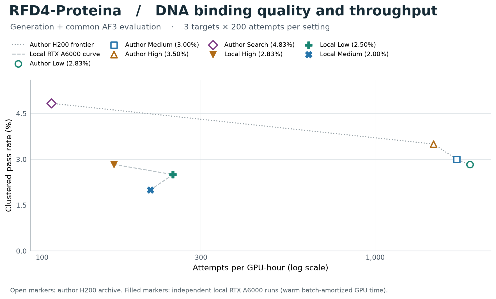
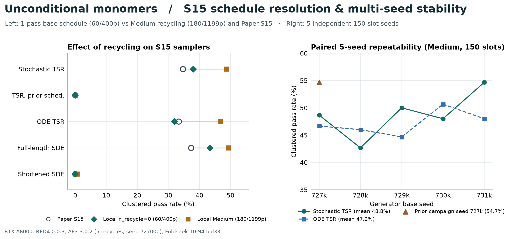

# RFD4-Proteina Paper Reproduction Overview & Guide

This document is the unified English entry point for all paper reproduction experiments, side-by-side numerical comparisons, scripts, and data artifacts in `tasks/rfd4-inference-search`.

- **Paper:** *Biomolecular design through latent reasoning with RFD4-Proteina* (Corley, Didi, Kazman, Brent et al., bioRxiv v1, 2026-11-15, DOI [`10.64898/2026.11.12.766037`](https://doi.org/10.64898/2026.11.12.766037)) · [Supplement PDF](https://www.biorxiv.org/content/biorxiv/early/2026/11/15/2026.11.12.766037/DC1/embed/media-1.pdf?download=true) · [Official leaderboard](https://rfd4-proteina.org/leaderboard.html)
- **Pinned software & assets:** `rfproteina 0.0.3` weights (`a06e2509c7033b010fc43614e9fd840303588502`), upstream configs/benchmarks (`6306a210dd17dcae8e4e0f381b5b74a719d9b30e`), AlphaFold 3 `3.0.2` (`f6a5aecf6eea2b5de4f846df86921630c5036b0b`, 5 recycles, 1 diffusion sample), Foldseek `10-941cd33`.
- **Local hardware:** 4× NVIDIA RTX A6000 (48 GB, driver `535.309.01`, eager `bf16-mixed`).

---

## 1. Navigation Index (Scripts, Data, Figures, and Sub-Reports)

| Study | Runner & Plotter Scripts | Reference Data & Figures | Detailed Sub-Report |
| --- | --- | --- | --- |
| **Figure 2 / Table S29 (4 suites, 16 points & 4-track AutoResearch)** | [`run_suite_cohort.py`](figure2/run_suite_cohort.py) · [`update_measured_figure2.py`](figure2/update_measured_figure2.py) · [`evaluate_tracks.py`](../environment/evaluation/evaluate_tracks.py) · [`benchmark_curve.py`](../environment/references/overall/benchmark_curve.py) | [`baseline_frontier_reference.csv`](../environment/references/overall/measured/baseline_frontier_reference.csv) · [`comparison_vs_paper.csv`](../environment/references/overall/measured/comparison_vs_paper.csv) · [`reproduced_targets.csv`](../environment/references/overall/reproduced_targets.csv) · [`generation.png`](../environment/references/overall/measured/generation.png) | [`FIGURE2_REPRODUCTION_GAPS.md`](FIGURE2_REPRODUCTION_GAPS.md) · [`overall/README.md`](../environment/references/overall/README.md) |
| **Figure 2 DNA binding (`Low`, `Medium`, `High`, independent GPU)** | [`run_dna_cohort.py`](dna-binding/run_dna_cohort.py) · [`plot_dna_curve.py`](dna-binding/plot_dna_curve.py) | [`side_by_side_summary.csv`](../environment/references/dna_binding/side_by_side_summary.csv) · [`trials_all.csv`](../environment/references/dna_binding/trials_all.csv) · [`quality-throughput-dna-af3.png`](../environment/references/dna_binding/quality-throughput-dna-af3.png) | [`dna_binding/README.md`](../environment/references/dna_binding/README.md) |
| **Table S15 samplers (`n_recycle=0` vs `thinking_medium`) & 5-seed repeats** | [`run_cohort.py`](s15/run_cohort.py) · [`run_monomer_cohort.py`](s15/run_monomer_cohort.py) · [`plot_schedule_and_repeats.py`](s15/plot_schedule_and_repeats.py) | [`base_schedule_summary.csv`](../environment/references/s15/base_schedule_summary.csv) · [`summary.csv`](../environment/references/s15/summary.csv) · [`multi_seed_repeats.csv`](../environment/references/s15/multi_seed_repeats.csv) · [`s15-schedule-and-repeats.png`](../environment/references/s15/s15-schedule-and-repeats.png) | [`docs/s15/README.md`](s15/README.md) |
| **Monomer scaling & official AF3-guided Beam (`L=100,150,250`)** | [`run_monomer_beam.py`](monomer-beam/run_monomer_beam.py) · [`plot_monomer_beam.py`](monomer-beam/plot_monomer_beam.py) | [`matched_30slot_summary.csv`](../environment/references/monomer_beam/matched_30slot_summary.csv) · [`scaling_150slot_summary.csv`](../environment/references/monomer_beam/scaling_150slot_summary.csv) · [`monomer-quality-throughput.png`](../environment/references/monomer_beam/monomer-quality-throughput.png) | [`monomer_beam/README.md`](../environment/references/monomer_beam/README.md) |
| **Table S16 (`SAM_hbonds` beam-search ablation)** | [`run_s16_hbonds.py`](s16/run_s16_hbonds.py) · [`plot_s16_hbonds.py`](s16/plot_s16_hbonds.py) | [`summary.csv`](../environment/references/s16/summary.csv) · [`designs.csv`](../environment/references/s16/designs.csv) · [`s16-hbonds.png`](../environment/references/s16/s16-hbonds.png) | [`s16/README.md`](../environment/references/s16/README.md) |
| **Autoencoder 640-structure temporal holdout** | [`validate.py`](ae-holdout/validate.py) | [`results.json`](ae-holdout/results.json) | [`ae-holdout/README.md`](ae-holdout/README.md) |
| **GPU release conformance & Table S28 audit** | [`replay_monomer.py`](gpu-pilot/replay_monomer.py) · [`audit.py`](../environment/references/s28/audit.py) | [`gpu-pilot/results.json`](gpu-pilot/results.json) · [`target_counts.csv`](../environment/references/s28/target_counts.csv) | [`gpu-pilot/README.md`](gpu-pilot/README.md) · [`s28/README.md`](../environment/references/s28/README.md) |

---

## 2. Side-by-Side Comparison: Paper vs. Local Reproduction

### 2.1 Figure 2 / Table S29 Across All Four Suites (`Low`, `Medium`, `High`, `Search`)

All 16 published Figure 2 / Table S29 RFD4 operating points (`564` target rows, `112,800` attempts) and 26 external comparator points are verified byte-for-byte in [`operating_points.csv`](../environment/references/overall/operating_points.csv) and consolidated with live local RTX A6000 measurements in [`baseline_frontier_reference.csv`](../environment/references/overall/measured/baseline_frontier_reference.csv). Across all four Figure 2 tracks (`Protein binding`, `Small-molecule binding`, `Enzyme scaffolding`, `DNA binding`), we have independently executed `29,400` fresh attempts (`147` target cohorts) on NVIDIA RTX A6000 (`rfd4-a6000-warm-v1`), with Wave 2 (`Medium`) and Wave 3 (`High`) continuing in the background:

| Track | Setting | Targets (Attempts) | Paper H200 clusters (rate) | Local A6000 passes / clusters (rate) | Rate diff | Paper H200 gen / total att/h | Local warm gen / total att/h | Paper yield (clus/GPU-h) | Local warm yield (clus/GPU-h) |
| --- | --- | ---: | ---: | ---: | ---: | ---: | ---: | ---: | ---: |
| **Protein binding** | **Low** | 24 (4,800) | 371 (7.73%) | 672 / **426 (8.88%)** | **+1.15 pp** | 2,388.3 / 820.7 | **136.0** / **89.5** | 72.48 | **9.81** |
| **Small-molecule binding** | **Low** | 77 (15,400) | 1,867 (12.12%) | 4,556 / **2,009 (13.05%)** | **+0.92 pp** | 7,740.8 / 1,813.8 | **551.1** / **241.6** | 223.32 | **31.92** |
| **Enzyme scaffolding** | **Low** | 37 (7,400) | 724 (9.78%) | 924 / **753 (10.18%)** | **+0.39 pp** | 5,160.8 / 1,335.9 | **323.7** / **160.9** | 142.10 | **17.35** |
| **DNA binding** | **Low** | 3 (600) | 17 (2.83%) | 15 / **15 (2.50%)** | -0.33 pp | 9,796.0 / 1,924.9 | **673.1** / **247.1** | **54.43** | **6.18** |
| **DNA binding** | **Medium** | 3 (600) | 18 (3.00%) | 13 / **12 (2.00%)** | -1.00 pp | 6,653.5 / 1,757.8 | **460.5** / **211.6** | 52.72 | 4.23 |
| **DNA binding** | **High** | 3 (600) | 21 (3.50%) | 19 / **17 (2.83%)** | -0.67 pp | 4,029.0 / 1,496.6 | **283.0** / **164.3** | 52.30 | 4.66 |

- **Takeaway:** Independent local clustered pass rates agree closely across all four biomolecular design modalities (`+1.15 pp`, `+0.92 pp`, `+0.39 pp`, `-0.33 pp` at `Low`), validating the end-to-end conditioning, common AF3 refolding, and Foldseek `10-941cd33` clustering pipeline. New unified AutoResearch strategies (`infer.py`) are evaluated across all four tracks via [`evaluate_tracks.py`](../environment/evaluation/evaluate_tracks.py).



### 2.2 Table S15 Unconditional Monomer Samplers & Schedule Resolution

`configs/inference.yaml` enables `thinking_medium` recycling (`180` / `1,199` trunk passes) by default, whereas supplementary §S5.1.1 precedes the recycling section (§S7.2) and `configs/generation/inference_base.yaml` sets `n_recycle: 0` (`1` trunk pass/step = `60` / `400` passes). Running a complete 750-slot campaign under `n_recycle=0` resolves the `+12–14 pp` gap:

| Sampler (150 slots: 50 × L=100,150,250) | Steps | Paper S15 rate / time (s) | Local `n_recycle=0` (60/400p) clusters (rate / warm s) | Local `thinking_medium` (180/1199p) clusters (rate / warm s) |
| --- | ---: | ---: | ---: | ---: |
| **Stochastic TSR** | 60 | 34.7% / 2.99s | **57 / 150 (38.0% / 3.62s)** | 73 / 150 (48.7% / 10.06s) |
| **Stochastic TSR, prior schedule** | 60 | 0.0% / 2.97s | **0 / 150 (0.0% / 3.63s)** | 0 / 150 (0.0% / 9.95s) |
| **ODE TSR** | 60 | 33.3% / 3.04s | **48 / 150 (32.0% / 3.64s)** | 70 / 150 (46.7% / 10.12s) |
| **Full-length SDE** | 400 | 37.3% / 17.68s | **65 / 150 (43.3% / 22.39s)** | 74 / 150 (49.3% / 65.27s) |
| **Shortened SDE** | 60 | 0.0% / 2.95s | **0 / 150 (0.0% / 3.62s)** | 1 / 150 (0.7% / 10.02s) |

### 2.3 Repeatability & BF16 Trajectory Sensitivity (`82 vs 73` and 5-Seed Study)

- **Root cause of `82/150` vs `73/150`:** Checksums of weights, configs, and inputs were identical. Per-slot Kabsch alignment showed `0.052 Å` median native backbone RMSD at `L=100` (vs `24.79 Å` across distinct seeds), proving identical initial Gaussian draws; under `bf16-mixed` (`torch_deterministic=false`), 1-ULP non-associative reductions accumulate over 180 trunk passes (`0.052 / 0.269 / 0.742 Å` median RMSD at `L=100/150/250`), flipping marginal cases near `1.5 Å`.
- **Five-seed paired repeatability (`727000–731000`, `1,500` slots):** Stochastic TSR averaged **`73.2 / 150 = 48.8% ± 4.3%`** (`64–82` clusters) vs ODE TSR **`70.8 / 150 = 47.2% ± 2.3%`** (`67–76` clusters), giving a mean paired gain of **`+1.60 pp`** (`+1.4 pp` in Table S15).



### 2.4 Monomer Refinement Scaling & Official Native AF3-Guided Beam

On 30 matched slots (`10` each at `L=100, 150, 250`), official `inference_beam_example` (`24` internal AF3 calls/attempt = `720` calls) was evaluated with independent final AF3 seeds (`727000` and held-out `314159`), alongside 150-slot one-shot runs:

| Policy | Matched 30-slot passes (`314159`) | Matched 30-slot unique clusters (`314159`) | Matched 30-slot clusters/GPU-h | Paper-size 150-slot clusters (`727000`) | Paper-size 150-slot clusters/GPU-h |
| --- | ---: | ---: | ---: | ---: | ---: |
| **One-shot No-Recycle (60p)** | — | — | — | 57 / 150 (38.0%) | 96.3 |
| **Native Low (120p)** | 23 / 30 (76.7%) | 21 / 30 (70.0%) | **96.8** | 82 / 150 (54.7%) | **112.5** |
| **Native Medium (180p)** | 23 / 30 (76.7%) | 19 / 30 (63.3%) | 78.2 | 73 / 150 (48.7%) | 85.3 |
| **Native High (300p)** | 24 / 30 (80.0%) | 22 / 30 (73.3%) | 74.4 | **83 / 150 (55.3%)** | 73.6 |
| **Native AF3 Beam (24 AF3/att)** | **30 / 30 (100.0%)** | **26 / 30 (86.7%)** | 8.44 | — | — |

### 2.5 Supplementary Table S16 (`SAM_hbonds` Beam Search) & Additional Audits

| Study / Arm | Paper Result | Local `base_1pass` (`n_recycle=0`) | Local `midpeak` (150 passes) | Status |
| --- | ---: | ---: | ---: | --- |
| **S16 Stochastic TSR (60 steps)** | 14.24 H-bonds | 11.98 ± 2.99 (`31.7s`/run) | **13.71 ± 2.58** (median `14.0`) | Reproduced (`+1.80` over 400-step SDE, `5.94×` faster) |
| **S16 Prior-schedule TSR (60 steps)** | 5.18 H-bonds | 0.00 ± 0.00 | 0.04 ± 0.20 | Unscaled `1/t` churn on TSR mesh collapses H-bonds |
| **S16 Full-length SDE (400 steps)** | 12.72 H-bonds | **10.18 ± 2.96** (`188.2s`/run) | — | Reproduced |
| **S16 Shortened SDE (60 steps)** | 3.31 H-bonds | 2.60 ± 2.95 | **2.92 ± 3.19** | Reproduced |
| **Autoencoder temporal holdout (640 structures)** | Sub-Å reconstruction | **0.097 Å** mean Cα RMSD (`99.71%` seq ID) | — | All 640 structures verified on GPU |
| **Table S28 fixed-budget search (10 targets)** | 541 → 674 clusters (`+24.6%`) | 541 → 674 clusters (`+24.6%`) | — | Target-level archive audit verified |

---

## 3. Quick Commands to Verify & Reproduce

### Offline verification of all archived records, curves, and checked-in scripts

Run from `tasks/rfd4-inference-search`:

```bash
# Run all 31 protocol, curve, coordinate, and reproduction unit tests
python -m unittest discover -s tests -p "test_*.py" -v

# Clean rebuild of Figure 2 / Table S29 (16 RFD4 points + 26 comparators)
python environment/references/overall/verify_sources.py --rebuild /tmp/rfd4-figure2

# Verify independent DNA-binding Low/Medium/High attempt ledgers
python environment/references/overall/benchmark_curve.py --track "DNA binding" \
  --trials environment/references/dna_binding/trials_all.csv --output /tmp/dna-verify.csv
```

### Regenerate plots from checked-in summary/attempt tables

```bash
python docs/dna-binding/plot_dna_curve.py --dna-dir environment/references/dna_binding
python docs/s15/plot_schedule_and_repeats.py --s15-dir environment/references/s15
python docs/monomer-beam/plot_monomer_beam.py --mb-dir environment/references/monomer_beam
python docs/s16/plot_s16_hbonds.py --s16-dir environment/references/s16
```

### Full GPU cohort execution

See each study's sub-report for exact per-cohort GPU loop commands:
- DNA binding (`Low`, `Medium`, `High`): [`environment/references/dna_binding/README.md`](../environment/references/dna_binding/README.md#reproduction--verification)
- S15 samplers & multi-seed monomers: [`docs/s15/README.md`](s15/README.md#reproduction)
- Official AF3-guided monomer beam: [`environment/references/monomer_beam/README.md`](../environment/references/monomer_beam/README.md#reproduction)
- Table S16 `SAM_hbonds` beam search: [`environment/references/s16/README.md`](../environment/references/s16/README.md#reproduction)
- Harbor monomer baseline & private verifier: [`README.md`](../README.md#running) · [`docs/ACCEPTANCE.md`](ACCEPTANCE.md)

AF3 output-derived measurements are subject to the [AF3 Output Terms of Use](https://github.com/google-deepmind/alphafold3/blob/main/OUTPUT_TERMS_OF_USE.md).
