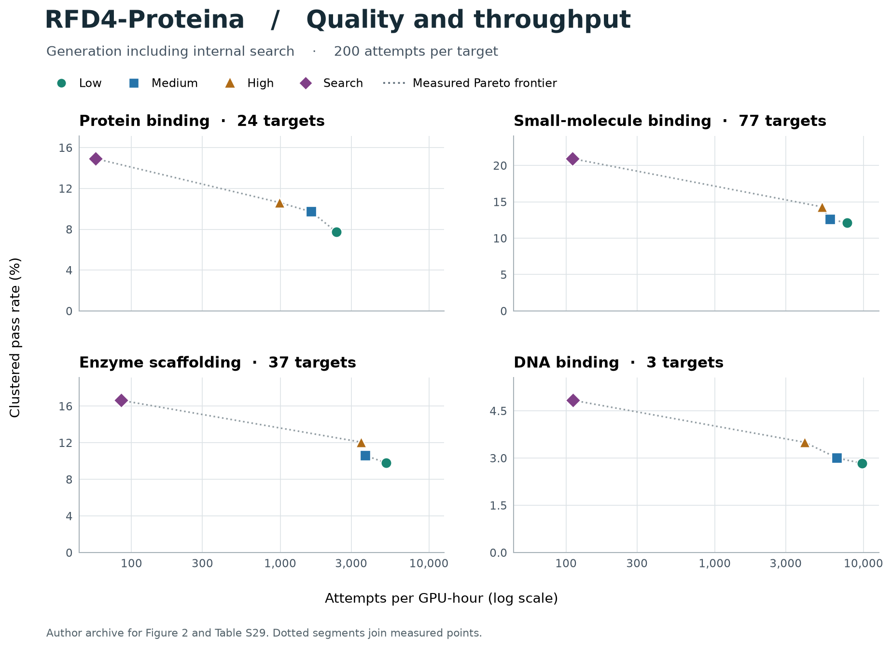

# RFD4-Proteina paper reproduction handoff

## Paper and scope

*Biomolecular design through latent reasoning with RFD4-Proteina* is a bioRxiv preprint from the University of Washington Institute for Protein Design (Baker Lab), NVIDIA and collaborators. Version 1 was posted on November 15, 2026, under DOI `10.64898/2026.11.12.766037`. Nathaniel Corley, Kieran Didi, Maxwell W. Kazman and Rafael I. Brent share first authorship. Kieran Didi and David Baker are the corresponding authors. [Paper](https://www.biorxiv.org/content/10.64898/2026.11.12.766037v1) · [Project page](https://rfd4-proteina.org/) · [Supplement](https://www.biorxiv.org/content/biorxiv/early/2026/11/15/2026.11.12.766037/DC1/embed/media-1.pdf?download=true)

RFD4-Proteina generates sequences and structures in a shared latent representation. It can spend inference compute refining a single sample or searching among trajectories with a structure predictor. The reproduction asks how many structurally distinct passing designs each strategy delivers for a given amount of GPU time.

This handoff records the evidence available at task version 0.2.4, experiment commit `8b1e202`. At that point all 16 published RFD4 operating points had been recalculated from author data, and all five S15 unconditional monomer samplers had been run locally. The four-suite measurements still came entirely from the author archive. Later experiments are documented in the reproduction guide and acceptance log. [Reproduction guide](REPRODUCE.md) · [Acceptance log](ACCEPTANCE.md)

## Official quality and throughput

Figure 2 compares three levels of refinement within a single draw. Table S29 compares High with predictor-guided Search. Each of the four settings starts 200 attempts per target across 141 targets, for 112,800 attempts in total. Final scoring uses a common AlphaFold 3 (AF3) evaluation. For each target, the numerator is the number of distinct Foldseek clusters containing a passing structure. The denominator includes all 200 attempts, including failures. The vertical axis averages those rates across targets. [Official benchmark and metric definitions](https://rfd4-proteina.org/leaderboard.html)

Each cell gives **clustered pass rate / generation attempts per GPU-hour**. Generation time includes predictors called during search. Final AF3 time is recorded separately. The values below are rounded from the authors' 564 target-level records. [Author data](https://github.com/RosettaCommons/RFD4-Proteina/blob/6306a210dd17dcae8e4e0f381b5b74a719d9b30e/website/benchmarks/source_data.csv) · [Full-precision operating points](../environment/references/overall/operating_points.csv)

| Suite (targets) | Low | Medium | High | Search |
| --- | ---: | ---: | ---: | ---: |
| Protein binding (24) | 7.73% / 2,388 | 9.71% / 1,619 | 10.63% / 986 | 14.92% / 57 |
| Small-molecule binding (77) | 12.12% / 7,741 | 12.58% / 5,974 | 14.32% / 5,242 | 20.94% / 111 |
| Enzyme scaffolding (37) | 9.78% / 5,161 | 10.61% / 3,745 | 12.07% / 3,496 | 16.64% / 85 |
| DNA binding (3) | 2.83% / 9,796 | 3.00% / 6,654 | 3.50% / 4,029 | 4.83% / 112 |

Search had the highest clustered pass rate in every suite. Including final AF3 time, the best yields in distinct passing clusters per GPU-hour were Medium for protein binding (78.0), High for small-molecule binding (237.1), High for enzyme scaffolding (155.2), and Low for DNA binding (54.4). For example, moving from High to Search on the small-molecule suite raised the pass rate from 14.32% to 20.94% and reduced hourly yield from 237.1 to 22.0. Each yield is calculated per target before averaging. [S29 and full yield comparison](../environment/references/overall/README.md)

The lowest-cost complete author point was DNA–Low. Its 600 attempts produced 17 passing clusters (2.83%). Throughput was 9,795.97 attempts per generation GPU-hour and 1,924.92 attempts per GPU-hour including final AF3. The authors used warm, batch-amortized timings. [DNA–Low timing record](../environment/references/overall/README.md#lowest-cost-complete-rfd4-point)

For an independent measurement, retain the model revision, device, seeds, original attempt counts, passing cluster counts, and separate generation and final AF3 GPU times. Compare pass rates in percentage points and throughput as a ratio. Label timings that include startup and compilation. Repeated draws give the variation needed to interpret differences. Rescoring archived structures checks the evaluator; independent generation requires fresh observations. This handoff covers published outcomes and the evaluation of frozen evidence for the functional suites. [Operating-point scorer](../environment/references/overall/benchmark_curve.py)

## Supplementary results

S15 measures unconditional monomer sampling. Each sampler generated 50 structures at each of 100, 150 and 250 residues. A sample passed at AF3 backbone self-consistency RMSD ≤ 1.5 Å. The rate counts distinct passing clusters. Local results below come from the RTX A6000 campaign using the released medium recycling schedule. [S15 settings and timings](s15/README.md)

| Sampler | Steps | Paper clustered pass rate | Paper time (s) | Local passing clusters / 150 |
| --- | ---: | ---: | ---: | ---: |
| Stochastic TSR | 60 | 34.7% | 2.99 | 73 / 150 (48.7%) |
| Stochastic TSR, prior schedule | 60 | 0.0% | 2.97 | 0 / 150 (0.0%) |
| ODE TSR | 60 | 33.3% | 3.04 | 70 / 150 (46.7%) |
| Full-length SDE | 400 | 37.3% | 17.68 | 74 / 150 (49.3%) |
| Shortened SDE | 60 | 0.0% | 2.95 | 1 / 150 (0.7%) |

The v1 PDF audit covered 18 rows across S15, S16, S18 and S22, plus the ten target-level rows in the separate fixed-budget S28 study. The other search comparisons use the following endpoints. [Published ablations](../environment/references/overall/ablation_results.csv) · [S28 source audit](../environment/references/s28/README.md)

| Study | Author result |
| --- | --- |
| S16, ligand contacts | Mean hydrogen-bond counts were 14.24 for stochastic TSR, 5.18 for its prior schedule, 12.72 for full-length SDE and 3.31 for shortened SDE. |
| S18, single peptide–DNA task | Over 24 GPU-hours per arm, independent sampling, fixed-criteria search and temporal search yielded 3, 0 and 9 passing clusters, respectively. |
| S22, six enzyme scaffolding targets | In the same method order, 24 GPU-hours per arm yielded 984, 639 and 603 clusters under regular evaluation, and 177, 165 and 217 under the high-burial criterion. |
| S28, ten targets | Independent sampling and interaction-guided early stopping yielded 541 and 674 clusters, respectively, in 40 GPU-hours per method, a 24.6% relative increase. The study did not isolate beam width as a separate effect. |

Independent comparisons need counts and timing at the endpoint of each study. Rebuilding the discovery curves in supplementary Figures S16–S17 additionally requires timed attempts and cluster assignments recomputed at each budget cutoff.

## Monomer follow-up identified at the time of the handoff

1. **Resolve S15 configuration differences.** Confirm the historical checkpoint, seeds, 400-step recycling schedule, hardware and timing boundaries with the authors. The local 400-step run stretched the public 60-step recycling schedule proportionally. Record which settings match and the remaining rate differences. [Local S15 protocol](s15/README.md)
2. **Measure repeatability.** Two full stochastic TSR campaigns using the same public seeds yielded 82 and 73 passing clusters. A same-device repeat of the 150-residue cohort yielded 28/50 twice. For matched repeats, cluster each seed's draws separately and report the distribution of paired differences. [Between-campaign comparison](../environment/references/s15/default-repeat.json) · [Same-device control](../environment/references/s15/same-device-repeat.json)
3. **Estimate the native monomer beam's quality and cost.** The pilot replayed the released AF3-guided beam twice, with two replicates and 48 internal AF3 evaluations per run. The selection order agreed at all eight checkpoints. The proposed extension was a comparison with Low, Medium and High at the three monomer lengths, reporting clustered pass rate and throughput both before and after final AF3. These are supplementary monomer measurements. [Beam pilot](gpu-pilot/README.md) · [Monomer baselines](../README.md#locally-measured-monomer-results)

The autoencoder reconstruction check covered all 640 fixed structures in the official temporal holdout. It measures the autoencoder component. The formal H100 AutoResearch trial was deferred while the reproduction evidence was being assembled. [Autoencoder results](ae-holdout/results.json) · [Acceptance record](ACCEPTANCE.md)
