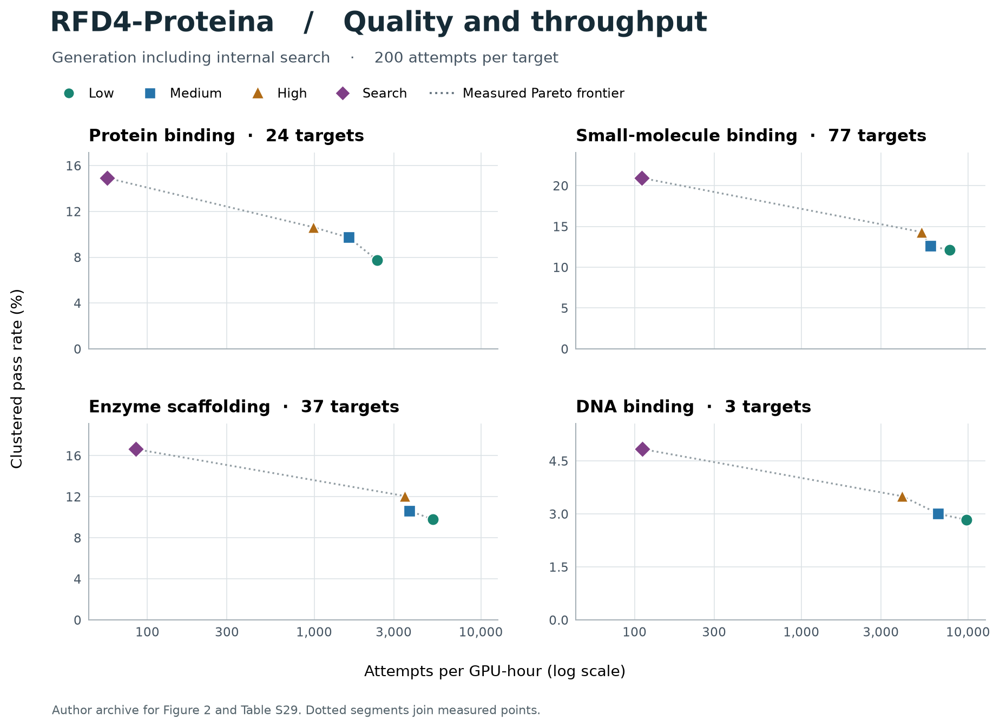

# RFD4-Proteina 论文复现交接

## 要复现的论文

**《Biomolecular design through latent reasoning with RFD4-Proteina》**，bioRxiv 预印本 v1，发布于 2026 年 11 月 15 日，DOI `10.64898/2026.11.12.766037`。这项工作由华盛顿大学蛋白质设计研究所（Baker Lab）、NVIDIA 等团队合作完成。四位共同第一作者为 Nathaniel Corley、Kieran Didi、Maxwell W. Kazman 和 Rafael I. Brent，通讯作者为 Kieran Didi 和 David Baker。[论文 v1](https://www.biorxiv.org/content/10.64898/2026.11.12.766037v1) · [作者项目页](https://rfd4-proteina.org/) · [v1 补充材料](https://www.biorxiv.org/content/biorxiv/early/2026/11/15/2026.11.12.766037/DC1/embed/media-1.pdf?download=true)

RFD4-Proteina 在共享的潜在表示中生成生物分子的序列与三维结构。模型可以在一次生成中反复细化表示，也可以在多条候选轨迹之间利用预测器评分做搜索。作者在四个计算设计基准上报告，RFD4-Proteina 的去重通过率和生成吞吐量同时超过了图中比较的既有方法。我们希望用公开模型重现这条质量–速度曲线，并回答一个实际问题：在相同 GPU 时间里，哪种设置能给出最多不同的通过结构？[论文与模型说明](https://rfd4-proteina.org/) · [作者的交互式基准](https://rfd4-proteina.org/leaderboard.html)

**当前进度。** 任务版本 `0.2.4`、实验记录提交 `8b1e202`。Figure 2 / S29 的 16 个 RFD4 点已全部从作者归档重算，本机独立生成仍为 **0/16**。S15 的五种无条件单体采样器均已在本机实跑，可追溯到每次尝试。正式 AutoResearch 端到端验收后置。[四赛道归档](../environment/references/overall/operating_points.csv) · [单体实测](../environment/references/s15/summary.csv)

## 1. 官方主图报告了什么

正文 Figure 2 比较 Low、Medium、High 三种单次采样设置，依次增加模型内部的细化计算。补充表 S29 将 High 与预测器引导的 Search 直接比较。每种设置对每个目标给出 200 次原始尝试，四种设置覆盖 141 个目标，共 112,800 次。最终评价使用共同的 AlphaFold 3（AF3）评估；对每个目标，统计含有通过样本的不同结构簇数，除以 200，再跨目标取平均。这样，同一折叠多次通过只计一个簇，失败尝试仍计入分母。[作者基准与指标定义](https://rfd4-proteina.org/leaderboard.html)

每格依次列出 **去重通过率 / 生成吞吐量（次尝试/GPU 小时）**。数值由作者发布的 564 行目标级记录重算；生成耗时包含搜索内部的预测器开销，最终 AF3 单独计时。表中通过率取两位小数，吞吐量取整数。[作者原始数据](https://github.com/RosettaCommons/RFD4-Proteina/blob/6306a210dd17dcae8e4e0f381b5b74a719d9b30e/website/benchmarks/source_data.csv) · [本仓库全精度结果](../environment/references/overall/operating_points.csv)

| 赛道（目标数） | Low | Medium | High | Search |
| --- | ---: | ---: | ---: | ---: |
| 蛋白结合（24） | 7.73% / 2,388 | 9.71% / 1,619 | 10.63% / 986 | 14.92% / 57 |
| 小分子结合（77） | 12.12% / 7,741 | 12.58% / 5,974 | 14.32% / 5,242 | 20.94% / 111 |
| 酶支架（37） | 9.78% / 5,161 | 10.61% / 3,745 | 12.07% / 3,496 | 16.64% / 85 |
| DNA 结合（3） | 2.83% / 9,796 | 3.00% / 6,654 | 3.50% / 4,029 | 4.83% / 112 |

**“最好”取决于评价指标。** 按每 200 次尝试能得到多少不同的通过结构，四条赛道都是 Search 最高。按**包含最终 AF3 的每 GPU 小时通过簇数**，四条赛道的最高点依次是蛋白结合 Medium（78.0）、小分子结合 High（237.1）、酶支架 High（155.2）、DNA 结合 Low（54.4）。例如，小分子赛道从 High 到 Search，去重通过率从 14.32% 升到 20.94%，但每 GPU 小时的通过簇从 237.1 降到 22.0。后一个指标先在每个目标上计算，再跨目标取平均。[补充表 S29](https://www.biorxiv.org/content/biorxiv/early/2026/11/15/2026.11.12.766037/DC1/embed/media-1.pdf?download=true) · [四种设置的完整产出率](../environment/references/overall/operating_points.csv)

### 独立复现还缺什么

**最小完整参照点是 DNA–Low。** 作者归档给出 600 次尝试、17 个不同的通过簇、去重通过率 2.83%。作者记录的生成吞吐量为 9,795.97 次/GPU 小时，包含最终 AF3 后为 1,924.92 次/GPU 小时。这三个量回答不同的问题，均应保留。目前没有可填入“本机实测”栏的独立数字，差值也应留空。作者的速度采用预热后、按批摊销的计时，本机若只记录含启动和编译的总耗时，应单独列一栏。[DNA–Low 来源和计时说明](../environment/references/overall/README.md#lowest-cost-complete-rfd4-point)

**单点验收。** 收到一份独立测量后，保留运行来源、模型版本、设备、种子、全部原始尝试数、去重通过簇数，以及生成和最终 AF3 两段 GPU 时间。按官方口径，纵轴是各目标去重通过率的平均；生成吞吐量是总尝试数除以总生成 GPU 小时，搜索内部开销计入生成。另报包含最终 AF3 的吞吐量。结果表并列作者值、独立值、通过率差（百分点）和吞吐量比。归档重算应能还原发表值；独立采样可能波动，判断一致性时要报告重复次数和波动范围。固定旧输出重评分可以验证评价器，只有新运行的记录才能填入独立生成一栏。[已有数值比较器](../environment/references/overall/benchmark_curve.py)

四赛道和下表中的功能实验涉及针对具体生物靶标的设计。本交接记录它们的证据缺口及冻结结果的验收方式。对具有双重用途风险的靶标，生成、筛选并迭代增强功能的操作不在助手可代执行的范围内。

## 2. 与推理搜索有关的补充表

**S15 回答的是采样器本身的效率。** 作者在长度 100、150、250 的无条件单体上各做 50 次尝试，每种采样器共 150 次，以 AF3 复折叠后的主链自洽 RMSD ≤ 1.5 Å 判定单个样本通过，再按结构去重。下表将论文原值与本机最近一次完整运行并列。秒数沿用论文口径，本机运行使用 RTX A6000。[论文表 S15](https://www.biorxiv.org/content/biorxiv/early/2026/11/15/2026.11.12.766037/DC1/embed/media-1.pdf?download=true) · [本机实验设置及计时](s15/README.md)

| 单体采样器 | 步数 | 论文去重通过率 | 论文时间（秒） | 本机去重通过数 / 150（通过率） |
| --- | ---: | ---: | ---: | ---: |
| 随机 TSR | 60 | 34.7% | 2.99 | 73 / 150（48.7%） |
| 随机 TSR，旧调度 | 60 | 0.0% | 2.97 | 0 / 150（0.0%） |
| ODE TSR | 60 | 33.3% | 3.04 | 70 / 150（46.7%） |
| 完整 SDE | 400 | 37.3% | 17.68 | 74 / 150（49.3%） |
| 缩短 SDE | 60 | 0.0% | 2.95 | 1 / 150（0.7%） |

| 论文实验 | 已核对的原始结果 | 尚缺的独立证据 |
| --- | --- | --- |
| S16，四种采样器的配体接触对照 | 平均氢键数分别为随机 TSR 14.24、旧调度 TSR 5.18、完整 SDE 12.72、缩短 SDE 3.31 | 同一终点的独立测量。 |
| S18，单个肽–DNA 任务的三种搜索方法 | 每组 24 GPU 小时。独立采样得到 3 个通过簇，固定判据搜索 0 个，随时间改变判据的搜索 9 个 | 三组各自的通过簇数、耗时和可追溯记录。 |
| S22，六个酶支架目标的搜索比较 | 每组 24 GPU 小时。按独立采样、固定判据搜索、随时间改变判据的搜索排序，常规评价下分别得到 984、639、603 个通过簇，采用论文的高埋藏度评价时分别为 177、165、217 个 | 每种评价条件下各自的独立簇数和每 GPU 小时产出。 |
| S28，十个目标的固定预算比较 | 每种方法共 40 GPU 小时。独立采样与相互作用引导的提前停止分别得到 541 和 674 个通过簇，相对提升 24.6% | 两组独立测量及成本记录。该表没有单独测量加宽 Beam 带来的增益。 |

本次按 v1 补充 PDF 复核了 S15、S16、S18、S22 的 18 行，并核对了 S28 的目标级计数。S28 是一项独立的同成本研究，不是复现 Figure 2 的前置条件。若还需还原补图 S16–S17 随预算增长的发现曲线，终点汇总不足以推回曲线，需要带时间的逐次记录和各预算截点的重新聚类结果。[补充表数据](../environment/references/overall/ablation_results.csv) · [S28 核对记录](../environment/references/s28/README.md)

## 3. 本机能继续核实的复现问题

- [ ] **解释 S15 的绝对值差异。** 已对五种方法各做 150 次生成、AF3 复折叠和 Foldseek 聚类。最新一轮随机 TSR 为 73/150（48.7%），论文为 34.7%；400 步 SDE 为 74/150（49.3%），论文为 37.3%。先向作者确认 S15 的模型权重版本、种子、400 步回收调度，以及表中秒数的硬件和计时范围。现有 400 步结果采用本地约定，将公开的 60 步回收调度按比例展开。验收时列出已对齐的设置、仍未知的设置和剩余差值。[五组设置、结果及原始记录](s15/README.md)
- [ ] **量化单体结果的重复波动。** 随机 TSR 在两次同种子完整运行中分别得到 82 和 73 个通过簇；额外的同卡 150 残基对照两次都是 28/50。可先用保存的配置和逐样本记录核查两次完整运行，再以预先确定的多组种子做配对重复。按每组种子独立聚类并计分，保存每次结果、差值和波动范围。这里要回答的是观察到的差距能否稳定重现。[跨批次比较](../environment/references/s15/default-repeat.json) · [同卡对照](../environment/references/s15/same-device-repeat.json)
- [ ] **如需判断官方单体 Beam 在本机的收益，补足小样本对照。** 官方无条件单体 Beam 已完整运行两遍，每遍两个重复、48 次内部 AF3 求值，八个检查点的选择顺序一致。现有证据足以核查搜索执行。要估计质量与速度，可沿用单体实验的 100、150、250 三种长度，比较 Low、Medium、High 和原生 Beam，分别报告去重通过率、生成吞吐量、含最终 AF3 的吞吐量。仓库另有两种以几何分数筛选的 Beam 基线。扩大原生 Beam 样本量属于**本地补充对照**，其结果单独作图，不计入官方四赛道的 16 个点。[原生 Beam 实测](gpu-pilot/README.md) · [现有单体基线](../README.md#locally-measured-monomer-results)

640 个官方固定结构的自编码器重建已经全部完成。这一项验证模型组件的重建精度，可以直接引用现有结果。开发新搜索策略、让研究 Agent 自主试验、在 H100 上做正式端到端验收，均留待论文复现结果整理之后。[640 个结构的验证结果](ae-holdout/results.json) · [现有环境验收记录](ACCEPTANCE.md)
