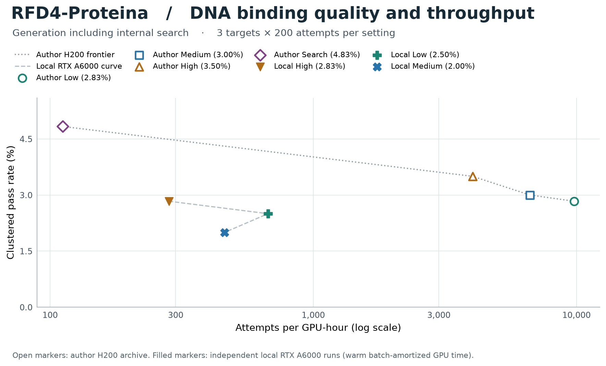
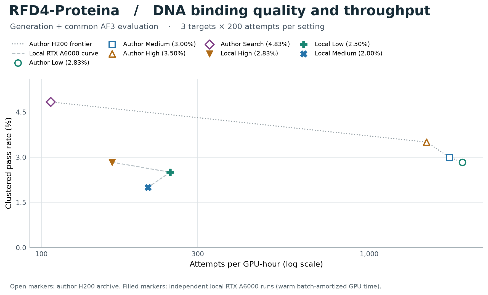

# Independent DNA-binding benchmark reproduction (Low, Medium, High)

This directory contains controller-owned per-attempt and per-target measurements for the three one-shot RFD4-Proteina settings (**Low**, **Medium**, **High**) on the full Figure 2 DNA-binding benchmark (`dna_unfixed`, criterion `dna`: `7m5w`, `7n5u`, `7rte`, 200 original attempts per target and method, 1,800 attempts total).

## Experimental setup

- **Model and inputs.** Released native `rfproteina 0.0.3` weights (`a06e2509c7033b010fc43614e9fd840303588502`, SHA-256 `5b549dd6...`), sequence-context DNA inputs (`120–150` residue binder length, unfixed DNA conformation) from pinned upstream commit `6306a210dd17dcae8e4e0f381b5b74a719d9b30e`.
- **Schedules (§S8.3).** `Low` uses `low/front_loaded` (120 trunk passes), `Medium` uses `medium/front_loaded` (180 trunk passes), and `High` uses `high/flat` (5 passes at every step = 300 trunk passes). Generation ran in eager BF16 at `batch_size=5` on NVIDIA RTX A6000 GPUs (seeds `727001`, `727002`, `727003` for `7m5w`, `7n5u`, `7rte`).
- **Common AF3 and clustering (§S8.2, §S12).** Final evaluation used `rfd4-evaluate` (`metrics_tags=[design,dna_refolding,interchain_interactions]`), official AF3 parameters (seed `727000`, five recycles, one diffusion sample, XLA attention, 256-token bucket) via the pinned persistent `oracle-exec` runtime, and Foldseek `10-941cd33` (`easy-cluster --alignment-type 1 --cov-mode 0 --min-seq-id 0 --tmscore-threshold 0.5`) separately per method and target. Passing designs satisfy `oracle_dna.min_ipae_coi ≤ 1.5` and `refolded_target_aligned_binder_rmsd.rmsd ≤ 8.0 Å`.
- **Dual timing ledgers.** `trials_warm.csv` records warm batch-amortized generation GPU-seconds (excluding cold batch-0 initialization) and warm persistent-worker AF3 GPU-seconds (after a throwaway XLA compilation warmup fold). `trials_cold.csv` records full end-to-end wall times including process startup, weight loading, and XLA compilation.

## Author archive vs local independent runs

| Setting | Author clusters / 600 (rate) | Local passes / clusters / 600 (rate) | Rate diff | Author gen att/h (H200) | Local warm / cold gen att/h (A6000) | Gen speed ratio (warm) | Author yield (clus/GPU-h) | Local warm / cold yield (clus/GPU-h) |
| --- | ---: | ---: | ---: | ---: | ---: | ---: | ---: | ---: |
| DNA–Low | 17 / 600 (2.83%) | 15 / **15** / 600 (**2.50%**) | -0.33 pp | 9,796.0 | **673.1** / 630.9 | 0.069× | 54.43 | **6.18** / 5.59 |
| DNA–Medium | 18 / 600 (3.00%) | 13 / **12** / 600 (**2.00%**) | -1.00 pp | 6,653.8 | **460.5** / 441.2 | 0.069× | 44.30 | **4.23** / 3.90 |
| DNA–High | 21 / 600 (3.50%) | 19 / **17** / 600 (**2.83%**) | -0.67 pp | 4,029.0 | **283.0** / 275.5 | 0.070× | 52.32 | **4.66** / 4.39 |





## Reproduction & Verification

```bash
for method in Low Medium High; do
  for target in 7m5w 7n5u 7rte; do
    python docs/dna-binding/run_dna_cohort.py --method "$method" --target "$target" \
      --input-cif "/work/benchmarks/dna/${target}_sequence_context.cif.zst" \
      --assets /workspace/data/assets --work "/work/dna_suite/$method/$target" || exit 1
  done
done
python docs/dna-binding/plot_dna_curve.py --campaign-dir /work/dna_suite --out-dir environment/references/dna_binding
python environment/references/overall/benchmark_curve.py --track "DNA binding" \
  --trials environment/references/dna_binding/trials_all.csv --output /tmp/dna-verify.csv
```

Files: [Side-by-side summary](side_by_side_summary.csv) · [Target breakdown](target_breakdown.csv) · [Operating points](operating_points_comparison.csv) · [Warm trials](trials_warm.csv) · [Cold trials](trials_cold.csv) · [Provenance](provenance.json)
