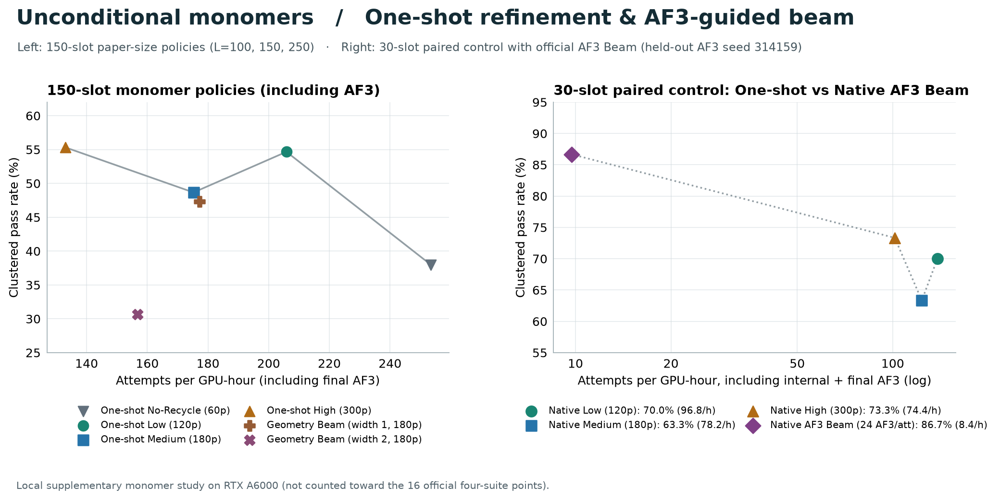

# Local unconditional monomer refinement & native AF3-guided beam comparison

This supplementary local study evaluates one-shot recurrent refinement (`No-Recycle`, `Low`, `Medium`, `High`) and the official AF3-guided monomer `Beam` (`inference_beam_example.yaml`) across the three standard unconditional lengths (`100`, `150`, `250` residues) on RTX A6000 GPUs. These target-free monomer results are reported separately and are not counted toward the 16 official four-suite operating points.

## 1. Matched 30-slot comparison (10 attempts per length: 100, 150, 250)

Each setting ran 10 independent draws per length (`seed = 727000 + length`). Native AF3-guided Beam (`beam_width=3, n_branch=2`, checkpoints `20, 40, 50, 60`, internal oracle seed `727000`) performed 24 internal AF3 evaluations per attempt (720 total) and emitted one rank-zero terminal structure per attempt by highest step-60 checkpoint reward with stable tie-breaking. All 120 finalists were independently scored with standalone AF3 `3.0.2` under both `seed=727000` and held-out `seed=314159`, then clustered per method and length with Foldseek `10-941cd33`.

| Policy | Passes / 30 (`314159`) | Unique clusters / 30 (`314159`) | Unique clusters / 30 (`727000`) | By length `100/150/250` (`314159`) | Gen+search att/GPU-h (wall) | End-to-end att/GPU-h | End-to-end clusters/GPU-h |
| --- | ---: | ---: | ---: | ---: | ---: | ---: | ---: |
| Native Low (120p) | 23 / 30 (76.7%) | **21 / 30 (70.0%)** | 21 / 30 (70.0%) | 6 / 8 / 7 | 391.7 | 138.3 | **96.8** |
| Native Medium (180p) | 23 / 30 (76.7%) | **19 / 30 (63.3%)** | 19 / 30 (63.3%) | 4 / 8 / 7 | 287.8 | 123.5 | 78.2 |
| Native High (300p) | 24 / 30 (80.0%) | **22 / 30 (73.3%)** | 24 / 30 (80.0%) | 7 / 7 / 8 | 189.2 | 101.5 | 74.4 |
| **Native AF3 Beam** | **30 / 30 (100.0%)** | **26 / 30 (86.7%)** | **26 / 30 (86.7%)** | **8 / 9 / 9** | 10.20 | 9.74 | 8.44 |

## 2. Paper-size 150-slot scaling (50 attempts per length, AF3 seed `727000`)

| Policy | Trunk passes / slot | AF3 passes / 150 | Passing clusters / 150 | Clustered rate | End-to-end att/GPU-h | End-to-end clusters/GPU-h |
| --- | ---: | ---: | ---: | ---: | ---: | ---: |
| One-shot No-Recycle | 60 | 97 | 57 | 38.0% | 253.4 | 96.3 |
| One-shot Low | 120 | 119 | 82 | 54.7% | 205.9 | **112.5** |
| One-shot Medium | 180 | 111 | 73 | 48.7% | 175.2 | 85.3 |
| One-shot High | 300 | 123 | **83** | **55.3%** | 132.9 | 73.6 |
| Geometry Beam (width 1) | 180 | 112 | 71 | 47.3% | 149.8 | 70.9 |
| Geometry Beam (width 2) | 180 | 101 | 46 | 30.7% | 129.0 | 39.6 |



## Reproduction

```bash
for length in 100 150 250; do
  python docs/monomer-beam/run_monomer_beam.py --length "$length" --replicates 10 \
    --gen-seed $((727000 + length)) --assets /workspace/data/assets --work "/work/monomer_beam/$length" || exit 1
done
python docs/monomer-beam/plot_monomer_beam.py --mb-dir environment/references/monomer_beam
```

Files: [30-slot summary](matched_30slot_summary.csv) · [30-slot by length](matched_30slot_by_length.csv) · [30-slot per-attempt table](matched_30slot_slots.tsv) · [150-slot scaling summary](scaling_150slot_summary.csv)
