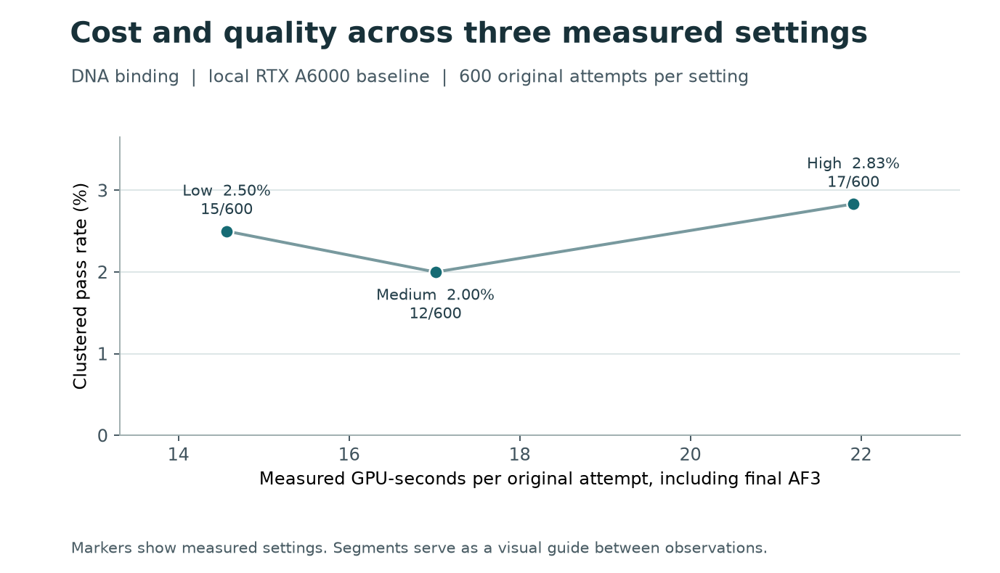

# Three-budget quality and cost standard

**Reporting protocol `rfd4-budget-curve-v1`.** The scientific question has two parts. How high is the clustered pass rate when the full allowance is available? How much absolute quality does the same program deliver as the allowance falls? Report both. One frozen submission and one fixed set of human reference packages supply the entire comparison.

## Budget and workload

| Tier | Fraction of maximum | Standard generation/search allowance per original attempt |
| --- | ---: | ---: |
| Tenth | B/10 | 6 seconds |
| Quarter | B/4 | 15 seconds |
| Full | B | 60 seconds |

The standard maximum is 60 seconds per original attempt on one allocated GPU. The tenth-budget endpoint tests a tenfold reduction in the generation allowance. Final AF3 can impose a cost floor, so the measured end-to-end range may be smaller. A request for multiple outputs has the corresponding allowance for all its slots combined. A program may finish early. Set the maximum and the three tiers before examining results. A different maximum defines a different comparison series.

Use identical submitted package bytes, reference packages, panel, target roster, attempts per target, repeat IDs, paired draws, device and driver at every tier. Keep software, frozen model assets and the evaluator fixed. Generation/search time covers the measured program invocation, including its startup and internal work. Common final AF3 time is measured separately under the paired warm-oracle convention. The cost plot uses the sum of these two measured times per original attempt. The points can also be expressed as generation or end-to-end attempts per GPU-hour. A wall-time allowance and measured end-to-end cost are distinct quantities.

In the authors' four suites, High had 17.2–47.4 times the generation throughput of Search. Including final AF3, the ratios were 10.0–15.4. These observed differences motivate a wide cost range. A tenfold sweep in allowed time does not establish that the most expensive historical Search configuration fits within the selected maximum. [Archived operating points](operating_points.csv)

Report dev, verify and full panels separately. Each full-panel tier covers the official 141 targets with 200 attempts per target per method per repeat. Cluster independently within each target, method, repeat and tier. Keep failed attempts in the denominator. The scorecard consumes completed independent measurements after evaluation. The current Harbor entry produces a single-budget result per invocation.

## Scores and interpretation

For each track, first compute each target's distinct passing clusters divided by original attempts. Average the target rates equally and express the result as a percentage. Average independent repeats equally, then average the four tracks equally for the macro percentage `Q(b)`.

| Question | Reported quantity |
| --- | --- |
| Full-budget quality | Use the measured `Q(B)` at the predeclared maximum. Its normalized primary value is `Q(B) / 100`. Keep this point even if a lower-budget result is higher. |
| Low-budget quality | Show `Q(B/10)` and `Q(B/4)` separately. Their arithmetic mean, as a percentage on the 0–100 scale, is the low-budget summary. |
| Improvement over human references | Within each tier and track, subtract the highest mean quality among the named, matched reference packages from the candidate's mean quality. Report the difference in percentage points. For the macro difference, average these four paired-panel differences. Show actual cost alongside each point. Equal budget caps allow different actual spending. |
| Quality retention | Within a track, divide the lower-tier quality by the full-tier quality. A zero full-tier denominator gives an undefined ratio. Retention can exceed one. Use absolute quality for ranking. |
| Variation | Show the number of repeats and the sample standard deviation of per-repeat quality in percentage points, when available. A single repeat supplies one observation. A claim about a persistent gain needs repeated evidence. |

The two quality endpoints remain separate. Interpolating a curve, selecting the best tier retrospectively, or forming an arbitrary weighted average can change the ranking. The plot therefore shows a marker at each observation and connects markers in budget order. Lower measured cost and higher quality are preferable. Nonmonotonic quality and cases where a larger allowance uses less time remain visible.

## Reporting frozen measurements

Supply three controller-owned directories, each containing the existing paired `summary.json` and `trials.csv` files. From the task root:

```bash
python environment/references/overall/budget_scorecard.py \
  --tenth /records/tenth --quarter /records/quarter --full /records/full \
  --max-budget 60 --output /reports/three-budget-check
```

Use a fresh output directory. The reporter checks the ledger hashes, cohort identities and counts; recomputes quality and measured throughput from the attempt records; and checks those values against the repeat summaries. Historical paper points and native warm-kernel timings remain separate reference series. A paper Low, Medium or High preset identifies a method setting and supplies no evidence that one submitted program ran at these three time limits.

The private suite digest identifies paired draws under the same pinned evaluator and repeat schedule. If public reports omit draw identity, include a controller-owned `budget_review.json` next to **each** summary. Its `summary_sha256` binds it to that exact summary. Its `draws_sha256` identifies the same frozen allocation of target, repeat, generation seed and final-evaluation seed across tiers. An optional boolean `all_arms_complete` records a controller review of completion for every candidate and reference cohort, including adjudicated early rejections. Keep this review and its source logs with the frozen results.

- `points.csv` gives each candidate and reference point, declared tier, measured generation and end-to-end seconds per original attempt, both throughputs, distinct passing clusters per end-to-end GPU-hour, clustered pass percentage and repeat SD.
- `scorecard.json` gives the full-budget primary value, both lower-tier rates, low-budget summary, paired differences and retention. It records the input report hashes and tier completion flags.
- `cost-quality.png` shows the measured points for each method across four panels.

A missing tier, mismatched package, workload, device or timing boundary, or inconsistent ledger prevents a three-tier report. With a matched but incomplete series the report is marked `descriptive_only`. Incomplete tiers keep their observed outcomes and original denominators. Paired gains require complete candidate and reference measurements. A complete candidate can still receive its standalone quality score when a baseline is incomplete. Retention requires complete candidate measurements at both tiers and positive full-tier quality. If an older summary omitted reference completion flags, the reporter requires a controller completion attestation before treating that tier as complete. A complete zero-pass cohort remains a measured zero. A recorded over-budget request disqualifies the tier. The report can certify a complete full-budget endpoint independently of the availability of qualified lower-tier comparisons.

## Example from recorded baselines

The DNA Low, Medium and High reference observations illustrate how the two axes read. They are three human presets. In 600 attempts per preset, Low yielded 15 passing clusters at 14.57 measured GPU-seconds per attempt, and High yielded 17 at 21.91 seconds, including final AF3. Low used 33.5% less measured time and retained 88.2% of High's clustered pass rate. Medium yielded 12 passing clusters; the measured curve retains the dip. [Frozen baseline coordinates](measured/points.csv)


