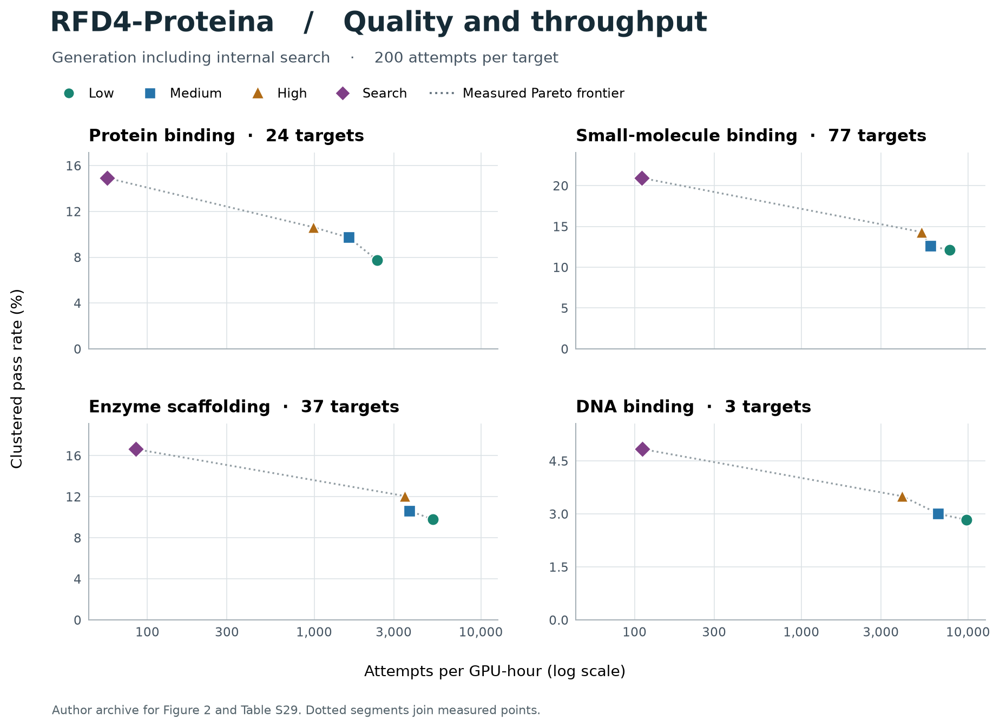

# Official RFD4 quality–throughput comparison

The overall comparison follows Figure 2 and supplementary Table S29. It covers 24 protein-binding targets, 77 small-molecule-binding targets, 37 enzyme scaffolding targets and three DNA-binding targets. Each method starts 200 attempts on each target, giving 28,200 attempts per method. Low, Medium and High are the three one-shot recurrent-refinement settings. Search is the authors’ predictor-guided pipeline. Its internal evaluations count toward generation time. The paper uses a common AF3 assessment for finalists. [Official benchmark explorer](https://rfd4-proteina.org/leaderboard.html) · [Supplementary §§S8.1, S8.5, S8.6 and S12](https://www.biorxiv.org/content/biorxiv/early/2026/11/15/2026.11.12.766037/DC1/embed/media-1.pdf?download=true)



## Starting points

The highest archived pass rate and the greatest end-to-end yield occur at different settings. Choose the comparison at the budget of interest and keep the whole curve for reporting. The efficiency column is the **mean target-level number of distinct passing clusters per GPU-hour including final AF3**.

| Suite | Highest clustered pass rate | Best end-to-end yield | Search end-to-end yield |
| --- | ---: | ---: | ---: |
| Protein binding | Search, 14.9% | Medium, 78.0 | 8.4 |
| Small-molecule binding | Search, 20.9% | High, 237.1 | 22.0 |
| Enzyme scaffolding | Search, 16.6% | High, 155.2 | 13.5 |
| DNA binding | Search, 4.8% | Low, 54.4 | 5.1 |

All 16 points are independently **recalculated from the authors’ frozen target-level counts and costs**. They remain author-run measurements. The [operating points](operating_points.csv) include two Pareto flags and the per-suite highest-rate and highest-yield flags. [Curve with common AF3 on the throughput axis](quality-throughput-af3.png)

## Metric conventions

For target *i*, let A be original attempts, C distinct passing structure clusters, G generation GPU-seconds including internal search, and F common final AF3 GPU-seconds. Native failures stay in A and their consumed time stays in G or F. The published warm cost excludes setup, loading, compilation, CPU scoring and idle allocations. Amortize batched GPU time over its attempts once.

| Quantity | Calculation across the targets of a suite |
| --- | --- |
| Clustered pass rate (%) | Mean of 100 × Cᵢ / Aᵢ |
| Figure 2 horizontal axis | 3600 × ΣAᵢ / ΣGᵢ |
| End-to-end throughput | 3600 × ΣAᵢ / Σ(Gᵢ + Fᵢ) |
| End-to-end unique yield | Mean of 3600 × Cᵢ / (Gᵢ + Fᵢ) |

The CSV also reports ordinary pass rate, covered targets and generation-only unique yield. Multiplying the two axes generally gives a different answer from the target-mean yield. For each submitted point the CSV also gives the pass-rate margin, in percentage points, over the best official point at equal or greater throughput. An empty margin means the submission ran faster than all four measured reference settings. The yield-gain column compares end-to-end clustered yield with the best official yield on that suite. These comparisons use the measured points directly.

Higher quality and higher throughput are both preferred. A point dominates another when it is at least as good on both axes and strictly better on one. Each panel has its own frontier. Connecting segments indicate the order of measured points. They do not establish performance at intermediate budgets. The budget-prefix curves in Supplementary Fig. 16 additionally require timed individual attempts and reclustering of subsets.

## Rebuild from the source tables

Run this operator command in this directory with Python and Matplotlib installed. Choose a new output directory. The script downloads and checks the pinned source tables, then derives the coordinates before reading any figure data for comparison.

```bash
python verify_sources.py --rebuild /tmp/rfd4-figure2
```

The output includes the two upstream CSVs under `inputs/`, the 564 RFD4 target measurements, 16 RFD4 operating points, both throughput plots, all 42 entries from the authors' plotting export, the comparator overlay and `receipt.json` with the source, code and output hashes. To repeat offline, use `--source-dir /tmp/rfd4-figure2/inputs --rebuild /tmp/rfd4-figure2-repeat`. The numeric replay uses the deposited target counts and time measurements. Image bytes can depend on the renderer and installed fonts.

The 38 displayed Figure 2 points plus the four S29 search overlays comprise 16 RFD4 settings and 26 other method/track points. On these archived data Low has higher clustered pass rate and generation throughput than every displayed external comparator in each panel. All four RFD4 settings lie on each panel’s measured frontier. The comparison uses the conditioning and timing accounting the authors specify for each method. The PPI Search timing note designates 20 of 4,800 original attempts as using an approved cost proxy. Eighteen comparator rows omit the end-to-end yield from the plotting export. For these rows the extra CSV reports the value derived from the target-level export and flags its provenance. The claim of frontier membership applies to this published comparison. [Compared points](comparison_field.csv) · [Four panels with comparators](quality-throughput-with-comparators.png)

## Reproduce or compare measurements

Run in this directory. Computing points and validating external observations use Python’s standard library. Rendering uses Matplotlib.

```bash
python benchmark_curve.py --output /tmp/points.csv --plot /tmp/quality-speed.png
python benchmark_curve.py --include-af3 --output /tmp/points.csv --plot /tmp/quality-speed-af3.png
python verify_sources.py
```

The source audit downloads two small CSVs from pinned code revision `6306a210dd17dcae8e4e0f381b5b74a719d9b30e`, checks their SHA-256 digests, selects the exact Figure 2 conditioning and pass definition, then recomputes the bundled data. The exported website tables identify manuscript data revision `18b7fc2cdbb14e71ab69935ca835c13cb0e82eb6`. The checks cover the target roster, counts, coverage, rates and times against the authors’ separate plotting table, and the printed precision of S29. For an offline audit use `--source-dir DIR` with the same two original files. [Per-target source](https://github.com/RosettaCommons/RFD4-Proteina/blob/6306a210dd17dcae8e4e0f381b5b74a719d9b30e/website/benchmarks/source_data.csv) · [Authors’ plotting data](https://github.com/RosettaCommons/RFD4-Proteina/blob/6306a210dd17dcae8e4e0f381b5b74a719d9b30e/website/benchmarks/scatter.csv)

The verifier image also contains this scorer at `/opt/rfd4-overall/benchmark_curve.py`. An operator can mount previously measured numeric records read-only and run the comparison offline. The archive calculation consumes no model-inference budget.

To compare a new **controller-owned measurement**, use one of the following inputs. The solver submission remains separate from this evidence. The offline comparator reads adjudicated counts or pass/cluster assignments and timings. Their provenance and the hardware and accounting match must be established by the operator. This entry point neither generates candidates nor performs AF3 or structural clustering.

```bash
python benchmark_curve.py --observations new-targets.csv --output /tmp/comparison.csv --plot /tmp/comparison.png
python benchmark_curve.py --trials new-attempts.csv --output /tmp/comparison.csv --include-af3 --plot /tmp/comparison-af3.png
```

- The target input follows the header of [targets.csv](targets.csv). Use a distinct method ID per measured setting and include the same targets, conditioning, pass criteria and 200 attempts in every cohort.
- The attempt CSV header is `dataset,criterion,method,target,attempt_id,scored,passed,cluster_id,generation_gpu_s,af3_gpu_s`. Record every original attempt, including early stops. The scored and passed fields take 0 or 1. Passing attempts require a cluster ID from the common evaluation. IDs are local to each target and method. Supply actual allocated GPU costs, including unsuccessful work. A measured zero is valid when a stage was skipped. Missing timing is an error.
- For native evaluator exports, append `pre_oracle_pass,all_metrics_present` to the attempt header. Map the latter from the applicable criterion’s completeness field. A passed prefilter followed by missing final metrics requires investigation. The pilot observed this exact state after an AF3 runtime failure even though the upstream evaluator wrote a zero pass flag. Pre-oracle rejections remain chargeable attempts. Archives using the shorter schema rely on prior controller adjudication.
- The scorer checks for duplicated attempts or targets, missing suites or targets, invalid counts and invalid costs. It counts distinct passing cluster IDs within target and method. The combined file and plot label operator-supplied observations separately and recompute the measured frontier. Statistical claims about a new algorithm require independent repeats under comparable conditions.

## Which paper experiments the archive supports

| Experiments | Evidence available here |
| --- | --- |
| Figure 2 and S29, Low / Medium / High / Search | Target-level numerical replay, checked against the figure export and the paper. Fresh independent four-suite model runs remain outstanding. |
| S15, stochastic TSR, prior-schedule TSR, ODE TSR, full and shortened SDE | Five author-reported sampler points. A separate local monomer experiment has real run records for the released stochastic sampler and two geometry search controls. |
| S16, four sampler variants within a search study | Four author-reported contact outcomes with a different endpoint. |
| S18 and S22, naive, constant-criteria and temporal search | Three and six reported rows respectively. Their reported clustered yields are checked from counts and budgets. |
| S28, independent sampling / interaction-guided early stopping | A separate ten-target fixed-budget study. The target counts reproduce its reported 24.6% gain. [S28 audit](../s28/README.md) |
| Recycling-window and schedule-shape ablations (S7.2), specificity and other Fig. 3 workflows, budget-prefix discovery curves (Figs. S16–S17) | Separate experiments with different cohorts, metrics or per-attempt data requirements. Their configurations have no validated four-suite operating point in this package. |

[Specialist study outcomes](ablation_results.csv) · [Local monomer run records](../../../README.md)

The PDF audit checks 18 specialist-study rows and eight High/Search S29 rows directly against the pinned supplement.

```bash
uv run --no-project --with pymupdf==2.1 python paper_tables.py /path/to/RFD4-Proteina-v1-supplement.pdf
```
