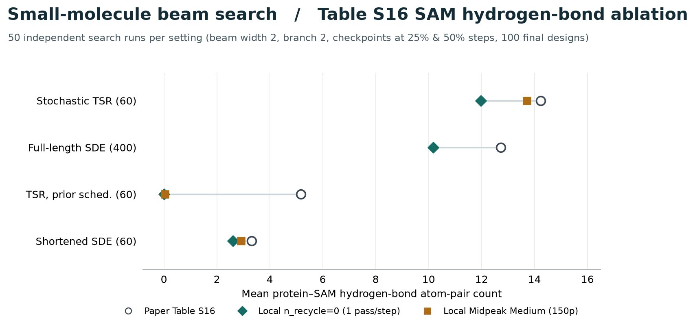

# Supplementary Table S16: SAM-binding hydrogen-bond search ablation

Following supplementary §S5.1.1 (Table S16), each sampler runs 50 independent beam-search trajectories (`beam_width=2`, `n_branch=2`, `seed=727000`) on the upstream `SAM_hbonds.cif.zst` input (`6306a210dd17dcae8e4e0f381b5b74a719d9b30e`), scoring completed rollouts by `interchain_interactions.hbond_atom_pair_count_coi` at 25% and 50% of integration steps (`15` and `30` for 60-step arms; `100` and `200` for 400-step `full-sde`) and retaining two final survivors per search run (100 designs per setting).

We measured all four samplers under the unrecycled base schedule (`base_1pass`, `n_recycle=0`: 1 trunk pass/step, matching §S5.1.1 before §S7.2 introduces recycling) and additionally measured the three 60-step arms under the released SM-binder medium midpeak schedule (`midpeak`, 150 passes over 60 steps).

| Sampler | Steps | Paper mean H-bonds | Local `base_1pass` mean ± SD | Local `midpeak` mean ± SD |
| --- | ---: | ---: | ---: | ---: |
| Stochastic TSR (default) | 60 | 14.24 | 11.98 ± 2.99 | **13.71 ± 2.58** |
| Stochastic TSR (prior schedule) | 60 | 5.18 | 0.00 ± 0.00 | 0.04 ± 0.20 |
| Full-length SDE | 400 | 12.72 | **10.18 ± 2.96** | — |
| Shortened SDE | 60 | 3.31 | 2.60 ± 2.95 | **2.92 ± 3.19** |

Under matched `base_1pass` compute, Stochastic TSR exceeds 400-step SDE by **+1.80 H-bonds** (`11.98` vs `10.18`, compared with `+1.52` in the paper: `14.24` vs `12.72`) while running **5.94× faster** (`31.68 s` vs `188.22 s` per search run on RTX A6000). Adding medium midpeak recycling raises Stochastic TSR to **13.71** (median `14.0`) and Shortened SDE to **2.92**, within `0.53` and `0.39` H-bonds of the printed values. The local `prior-tsr` reconstruction applies unscaled `1/t` churn on the TSR time mesh, which collapses protein–ligand H-bonds completely (`0.00–0.04`), whereas the authors' historical prior-schedule variant may have paired unscaled `β(t)` with a different mesh or clean-prediction checkpointing.



## Reproduction

```bash
for arm in stochastic-tsr prior-tsr full-sde short-sde; do
  python docs/s16/run_s16_hbonds.py --arm "$arm" --schedule-mode base_1pass \
    --sam-cif /work/benchmarks/sm/SAM_hbonds.cif.zst --assets /workspace/data/assets --work "/work/s16/base_1pass/$arm" || exit 1
done
python docs/s16/plot_s16_hbonds.py --s16-dir environment/references/s16
```

Files: [Summary](summary.csv) · [All 700 final designs](designs.csv)
