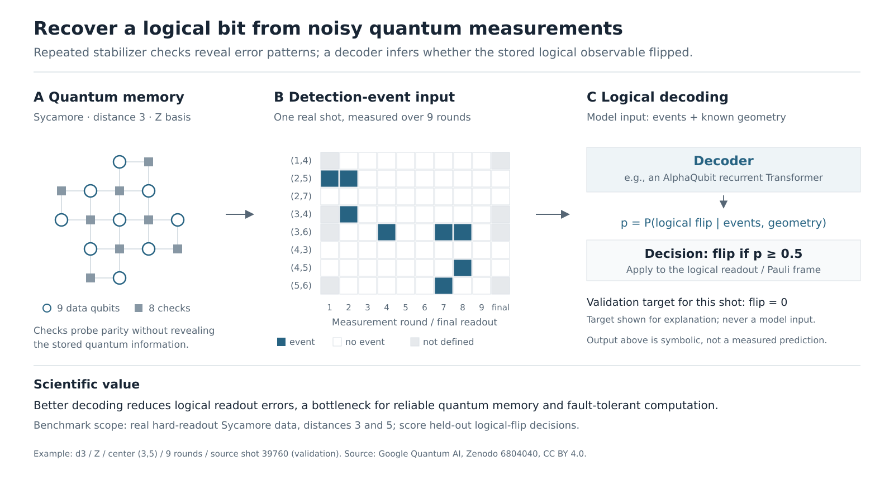

# Surface-code decoding



## 1. Overview

A model-development benchmark for quantum error correction: predict logical
observable flips from repeated surface-code stabilizer measurements. Better
inference reduces logical memory failures without changing the quantum hardware.
The released task uses real Sycamore d3/d5 hard-readout experiments. An independent
AlphaQubit reproduction is the reference model: its code and results are provided,
its trained weights are not, so every submission is trained from scratch.


| Item | Release v1.2 |
|---|---|
| Train / validation / test | 2,584,400 / 665,600 / 3,250,000 shots; physically separate |
| Conditions | 4 d3 patches + 1 d5 patch; X/Z bases; 13 odd durations 1..25 |
| Reference model | Independent AlphaQubit: recurrent Transformer, width 320, 3 blocks per round, 4 attention heads; code and results provided, weights withheld |
| Parameters | 8,449,990 per d3 specialist; 8,456,070 per d5 specialist; ten models, 84,512,060 total |
| Rules | random initialization; no pretrained or external checkpoints; no test access |
| Inference budget | 1 GPU, up to one hour; relocated artifact; no network; no labels |
| Submission | Trained model/decoder state plus `infer.sh INPUT_ROOT OUTPUT_ROOT` |
| Metric | One minus equal-distance/group/duration logical failure |
| Normalization | MWPM lower anchor 0.7160463461538461; strongest released TN reference upper anchor 0.7615159615384615 |
| Reference AlphaQubit v1 | P=0.7550607692307693; ≈200.4 GPU-hours (180.0 pretraining + 19.9 fine-tuning + 0.4 replay) on RTX PRO 6000 Blackwell, up to 8 at once |


**Status.** The integrator re-trained the reference recipe from scratch on H100s: reward (P) 0.75569, against the frozen
reference's 0.75506. The workspace follows
[TASK_STANDARD.md](../TASK_STANDARD.md).

## 2. Data

Use [immutable HF materialization](environment/data/MATERIALIZE.md) to deploy without
reprocessing the original raw archive. Development contains train/validation,
ideal circuits, allowed even-fitted DEMs, and the reference model's results and
submission template (no weights).
Input-only verifier data and private grader labels use separate role archives.
Never mount evaluation roles into the agent environment. The historical source
is public; isolation does not turn it into a new secret test dataset.

Controller commands: [`environment/data/MATERIALIZE.md`](environment/data/MATERIALIZE.md). What the agent sees:
[`environment/data/README.md`](environment/data/README.md). The development role (`TASK_DATA_DIR/development`) is mounted
per entry under `/workspace/data`; `TASK_DATA_DIR/verifier` feeds the verifier, and `TASK_PRIVATE_DIR` (grader labels) only the
trusted grader.

## 3. Workspace

| path | contents |
| --- | --- |
| `/workspace/instruction.md`, `/workspace/contract.md` | the prompt; input/output formats, package, inference limits |
| `/workspace/data/` | `README.md`; `train/`, `validation/`, `reference/`, `release.json`, `inventory.json` (read-only mounts) |
| `/workspace/baseline/alphaqubit/` | the task's Python project (`baselines/`, `qecbench/`, `reproduction/`, runtime lock, score config) on `PYTHONPATH`, with `README.md` and `RESULTS.md`; reproduced reward (P) **0.75569** |
| `/workspace/references/` | the anchors (MWPM, tensor network) and the published work |
| `/workspace/evaluation/` | validation staging and scoring with the verifier's code |
| `/workspace/submission/`, `/workspace/research/` | the current package (replaced atomically by `qecbench.package`), and writable scratch on a large disk |

In the repository the reference implementation is the Python project `environment/baseline/alphaqubit/`; the image copies it
to `/workspace/baseline/alphaqubit`, and the verifier image shares its `qecbench/`, `baselines/` and `score_config.json`.

## 4. Evaluation

The reward is the raw P; `report.json` also carries the normalized score
max((P-L)/(U-L),0) (score_config v1.1.0) as a diagnostic. The upper reference rescored published TN predictions
on the exact same test shots; it is not a newly implemented TN decoder. AlphaQubit
provides the from-scratch training implementation; its reference score is below
the TN upper anchor on this test split.
Scientific LER, error suppression and probability calibration remain diagnostic
outputs, separate from the reward.

The verifier replays the relocated package as UID 10001 on one GPU with no network, within one hour. A trusted CPU grader
writes `/logs/verifier/reward.json` (`reward`, the raw P) and `report.json` (P, the normalized score, per-distance failures,
scientific diagnostics). See [tests/README.md](tests/README.md).

## 5. Running

```bash
export TASK_DATA_DIR=/large-disk/surface-code TASK_PRIVATE_DIR=/protected-disk/surface-code/grader   # section 2
export TASK_RESEARCH_DIR=/large-disk/runs/surface-code-$(date +%s); mkdir -p "$TASK_RESEARCH_DIR"
harbor trial start -p surface-code-decoding -a <agent> -m <model> --allow-agent-host <model API host>
```

**External budget (`task.toml`, not told to the agent).** The v1.2 budget is 8 H100 GPUs, at least 64 CPU cores, 512 GiB memory, 1 TiB writable
storage, and 48 hours (384 allocated GPU-hours). The unchanged ten-specialist
reference recipe schedules one model per GPU in two waves, each with 18 hours
of pretraining and up to two hours of fine-tuning. Estimate 36–40 hours plus
packaging/validation, assuming all eight GPUs are available concurrently and
the existing microbatch/runtime fits. This is an operator policy and scheduling
estimate, not a measured H100 convergence or throughput claim. Our original
RTX PRO 6000 Blackwell Max-Q 96 GB run consumed about 180 pretraining + 20
fine-tuning GPU-hours; a faster GPU can process more training steps within the
time cap. The budget leaves approximately 8–12 hours for overhead and bounded
experiments, rather than several complete reference retraining runs.

Development defaults to `no-network` in `task.toml`; launch through the runner,
which applies that policy or an operator-selected model API allowlist. Development
Compose leaves networking to the runner/Harbor so the allowlist sidecar can
attach. Bare Compose does not apply the task policy. Both evaluation services
disable networking explicitly and remain offline. The evaluation `main` service
requests exactly one NVIDIA GPU; the trusted
`grader` requests none. The local replay overlay inherits that single GPU.
The synthetic CPU CI fixture explicitly resets this reservation; it does not
replace production GPU inference acceptance.


## 6. Results and validation

| run | P (reward) |
| --- | ---: |
| task author's frozen reference (RTX PRO 6000, ≈200 GPU-h) | 0.75506 |
| the same frozen reference, replayed by the integrator on H100 | 0.75507 |
| integrator, from scratch with `solution/solve.sh` on H100s (200 GPU-h, 40 h wall on 8 GPUs, two waves) | **0.75569** |

The original AlphaQubit campaign took approximately 200.3 allocated GPU-hours
for main training and full replay on RTX PRO 6000 Blackwell Max-Q 96 GB GPUs,
with 47.88 elapsed hours including queueing. These are measured CS costs, not
H100 timing claims. Main v1 test LER is 3.012653% at d3 and 3.228889% at d5;
the official paper's ensemble/protocol is different and headline accuracy was
not reproduced. See [compact results](environment/baseline/alphaqubit/reproduction/alphaqubit-summary.json).

Historical v1 release acceptance is recorded in [machine-readable evidence](docs/campaign/release-acceptance.json).
All 3.25 million test shots were freshly replayed in offline, input-only GPU
containers: P=0.7550636538461539 and score=0.858096277311141. Compared with
historical output, 25 decisions changed; the accepted historical reference
above remains fixed. Old/new adapters were bit-identical on 75,000 shots in a
same-process control. The precise source of cross-run numerical variation is
not established. Actual warm-start updates, arbitrary-N inference and native
Docker role-isolation checks also passed; the latter uses a synthetic fixture,
while full scientific GPU replay uses Apptainer.

Release history (v1.1: no weights for agents; v1.2: the budget): [`docs/RELEASES.md`](docs/RELEASES.md).

## 7. Limitations

- The historical test set is public upstream; runtime isolation is an execution boundary, not secrecy.
- The upper anchor rescored published tensor-network predictions on the same shots; it is not a re-implemented decoder.
- The official AlphaQubit paper's ensemble and protocol differ; its headline accuracy was not reproduced.

## 8. Citation and licenses

- [AlphaQubit, Nature 2024](https://www.nature.com/articles/s41586-024-08148-8): scientific architecture and training target; no official code/weights claim.
- [Google Quantum AI Sycamore data, Zenodo 6804040](https://zenodo.org/records/6804040): experimental data, CC-BY-4.0.
- [PyMatching](https://github.com/oscarhiggott/PyMatching): executable MWPM/correlated matching comparisons.
- [QRENND, Physical Review Research 2025](https://doi.org/10.1103/PhysRevResearch.7.013029): retained secondary LSTM implementation/provenance.
