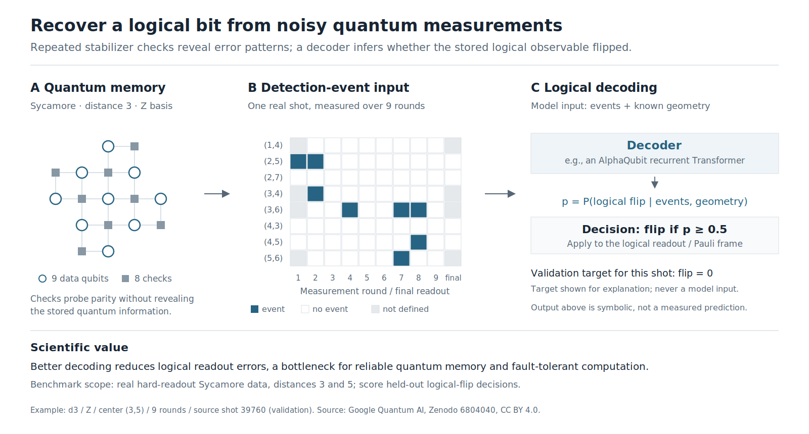

# Science introduction figure



The figure explains the scientific problem, data flow, and value of the task.
It shows **real public validation data**, not a constructed error pattern:
`surface_code_bZ_d3_r09_center_3_5`, zero-based source shot **39760**, the first
held-out even shot. The geometry, all 72 detector bits, and the official
logical-observable target come from that condition. Undefined first/final
checks are gray rather than zero-filled. The source is the
[Google Quantum AI Sycamore memory dataset](https://zenodo.org/records/6804040),
CC BY 4.0; the figure transforms one record into a lattice and event matrix.

The decoder probability and threshold are **symbolic**. No new model inference
or per-shot numerical prediction is claimed. The displayed validation target
is explanatory and is not a model input. No test shot or test label is included.
The diagram shows the current hard-readout d3/d5 task; it does not imply IQ-data
or distance-11 support, real-time latency, or an explicit physical-qubit recovery.

Files:

- `science-introduction.svg`: editable text and vector geometry, 1600 × 860.
- `science-introduction.png` and `.pdf`: rendered exports.
- `example.json`: source record, selection rule, file hashes, and attribution.
- `generate.py`: deterministic layout and export script.
- `extract_example.py`: reproduce the record from the original public source.

Regenerate the figure from the small committed record; the original dataset
and model weights are unnecessary:

```bash
uv run --with cairosvg==2.8.2 python docs/figures/generate.py
```

Run from the task directory. To audit the extraction against an expanded
Sycamore source release:

```bash
uv run --with numpy --with stim python docs/figures/extract_example.py \
  /path/to/sycamore/surface_code_bZ_d3_r09_center_3_5 \
  --output /tmp/surface-science-example.json
cmp docs/figures/example.json /tmp/surface-science-example.json
```

Rendering was checked visually at the exported PNG resolution. The SVG
contains selectable text; both text labels and geometry remain editable.
