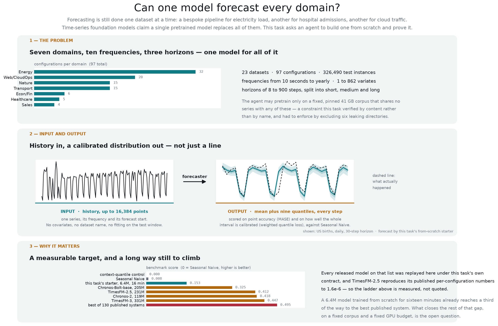
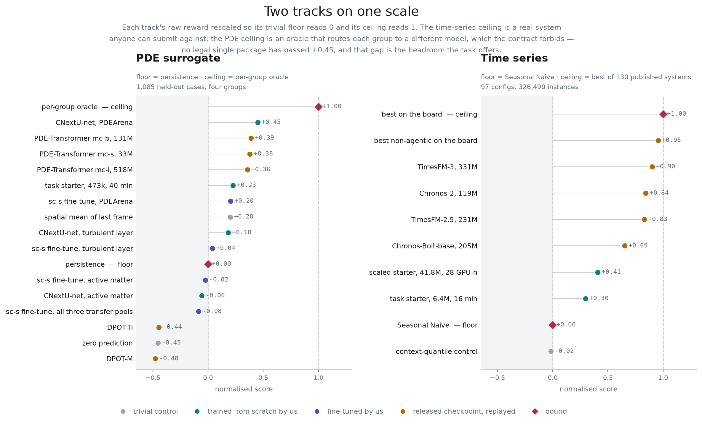

# timeseries-forecasting: a zero-shot time-series foundation model from scratch



*Regenerate with `python3 docs/make_science_intro.py --work <verifier work dir> --predictions <its output/>`. Four worked forecasts across domains are in [`docs/task_overview.png`](docs/task_overview.png) (`docs/make_task_overview.py`).*

## 1. Overview

**The task.** Pretrain one probabilistic forecaster from scratch on a fixed
corpus, then beat the released time-series foundation models zero-shot on all
97 GIFT-Eval configurations.

**Why it is hard.** The model sees a series once, at test time, and has never
seen that dataset. It gets the history and nothing else — no covariates, no
dataset name, no chance to fit. It must then emit not a line but a calibrated
distribution: a mean and nine quantiles for every step of a horizon that runs
from 6 to 900 steps, across seven domains, ten sampling frequencies from 10
seconds to a year, series with gaps, and up to 862 variates at once.

**The scientific question.** Whether one pretrained model really does replace
the per-dataset pipelines forecasting still runs on. This is what TimesFM,
Chronos, Moirai, TiRex and Toto compete on, and GIFT-Eval is the board they all
report; every rung of that ladder is replayed here rather than quoted.

**External target.** TimesFM-3 (`google/timesfm-3.0-pytorch`), the best
released zero-shot model on the public board at the pinned snapshot (one
fine-tuned Chronos-2, which the task's rules forbid, sits above it), replayed
under this task's protocol: relative MASE 0.669, relative WQL
0.458, **reward 0.447** (board: 0.667 / 0.456 / 0.449). Secondary targets: TimesFM-2.5 and
Chronos-2 (Apache-2.0), Chronos-Bolt. Released models were trained on
10^11-observation corpora for days on many GPUs; the task gives a 273 GB corpus and 8 GPUs for 48 hours (below), so matching them is the
research problem.

**Status.** Data pinned and verified file by file; every rung of the field replayed under the
task protocol; inference isolated per cutoff cohort. The integrator reproduced the Seasonal Naive
and trivial controls exactly and re-trained the starter (0.161 against 0.153 documented) and, for v2, trained the TimesFM-3-architecture
main baseline on eight H100s (0.275). The
workspace follows [TASK_STANDARD.md](../TASK_STANDARD.md).

## 2. Data


Two Apache-2.0 sources from the benchmark authors, pinned and verified file by
file (`environment/data/`, receipt in `docs/validation/`):

- `Salesforce/GiftEval` @ `30841734` (1.59 GB): the 97 configs; the verifier's
  only data. Test windows are the last 10% of every series (up to 20
  non-overlapping windows per series, one for M4), 326,490 instances.
- `Salesforce/GiftEvalPretrain` @ `6830b624`: 95 of 152 directories (273.21 GB, 63.2 G points; v1 had 81
  directories, 41.14 GB). v2 adds `buildings_900k`, `borg_cluster_data_2011`, ERA5 2010–2018 and CMIP6
  2000/2005/2010 after a 50M model overfit the 41 GB corpus (`docs/validation/corpus_scaling.json`); a content
  check found none of their series in GIFT-Eval (`docs/validation/extra_dirs_leak_check.json`).
  65 are excluded for size (934 GB of climate shards and two bulk sets) and six
  because they were measured to contain GIFT-Eval evaluation series up to an
  affine transform, which this corpus is advertised not to do: `m4_hourly` is
  `pedestrian_counts` plus a constant, correlation 1.000000 over the whole
  series including its test horizon (`docs/validation/corpus_leakage_verified.json`).
  Agents may add synthetic series generated by their own code; nothing else.

The agent sees the corpus and the validation windows (the window before each
test region, staged with labels); the test region is never mounted. The
protocol is transcribed from gift-eval's code and frozen in `split.json`.

**Materialization (controller).** `environment/data/MATERIALIZE.md`. One directory serves both
sides; set `TASK_DATA_DIR` and `TASK_PRIVATE_DIR` to it:

```bash
export TASK_DATA_DIR=/large-disk/timeseries TASK_PRIVATE_DIR=/large-disk/timeseries
python3 timeseries-forecasting/environment/data/materialize.py "$TASK_DATA_DIR"      # gifteval + the 95 corpus directories (275 GB)
python3 timeseries-forecasting/environment/evaluation/make_cases.py --data "$TASK_DATA_DIR" \
    --manifest timeseries-forecasting/environment/data/split.json --split valid \
    --input "$TASK_DATA_DIR/valid/input" --truth "$TASK_DATA_DIR/valid/truth"   # the agent's validation cases
```

## 3. Workspace

| path | contents |
| --- | --- |
| `/workspace/instruction.md` | the prompt |
| `/workspace/contract.md` | `timeseries-forecast/v1`: package, per-cohort calls, I/O format, runtime and time limit, scoring |
| `/workspace/data/` | `README.md`, `split.json`, `split_smoke.json`, `sources.lock.json`; `gifteval_pretrain/`, `valid/`, the receipt (read-only mounts) |
| `/workspace/baseline/timesfm3-50m/` | **main baseline**: the TimesFM-3 architecture (released Apache-2.0 code, random init) at 50.9M, 8-GPU data-parallel training with source-balanced sampling; reproduced reward **0.275** |
| `/workspace/baseline/starter-41m/` | the starter at 41.8M, 8-GPU data-parallel; reward **0.200** (author's single-GPU run 0.207) |
| `/workspace/baseline/starter/` | pack, train, publish (atomic) a 6.4M patched transformer; reproduced reward **0.161** |
| `/workspace/baseline/seasonal_naive/` | the normalizer as a package; reproduced reward **0.0075** |
| `/workspace/references/` | the leaderboard and the released-model replays (`released_models.md`), not verified by the integrator |
| `/workspace/evaluation/` | the grader, case builder, readers, validation normalizer, a synthetic contract example |
| `/workspace/submission/` | empty; the agent keeps the current package here |
| `/workspace/research/` | empty, writable, on a large disk (`TASK_RESEARCH_DIR`): the packed corpus and runs go here |

The test region, the external-target replay packages (they load forbidden checkpoints) and the
trivial control stay out of the workspace, in `docs/validation/released_models/`.

## 4. Evaluation


Per config (dataset, frequency, term), the two GIFT-Eval headline metrics
computed exactly as the leaderboard computes them (gluonts 0.15.1; agreement to
1.9e-7 on all 97 configs on the same forecasts, `docs/validation/golden_gluonts_full.json`): MASE of the
median forecast and the mean weighted quantile loss over the nine deciles (the
board's CRPS column). Each is divided by the leaderboard's own Seasonal Naive
value for that config and aggregated with a geometric mean, the board's
aggregation. Then

    reward = clip(1 − sqrt(rel MASE × rel WQL), 0, 1)

the geometric skill over Seasonal Naive: 0 = no better than Seasonal Naive on
average, 1 = perfect. Every published system's reward follows from its public
per-config CSV, so Table 2 places the field on the task's scale without
rerunning anything. Details: `environment/contract.md`.

**Normalised score.** The verifier writes `normalised_score` beside the raw `reward` in
`reward.json`, mapping it onto 0-1 between this track's reference floor and ceiling
(`environment/evaluation/score_bounds.json`): Seasonal Naive reads 0.000 and the best of the
130 complete leaderboard systems 1.000, so the task starter is 0.298, the scaled starter 0.409, the main baseline (timesfm3-50m) 0.547 and TimesFM-3 0.901.
`reward.txt` keeps the raw value. Both bounds here are real systems a submission can be
measured against, which is what makes the scale discriminate across its whole range.


## 5. Running

```bash
export TASK_DATA_DIR=... TASK_PRIVATE_DIR=...                      # section 2
export TASK_RESEARCH_DIR=/large-disk/runs/timeseries-$(date +%s); mkdir -p "$TASK_RESEARCH_DIR"
harbor trial start -p timeseries-forecasting -a <agent> -m <model> --allow-agent-host <model API host>
```

External budget (`task.toml`, not told to the agent): 48 hours on eight H100s, 64 CPU
cores, 512 GiB RAM, 1 TiB storage (the packed corpus alone is 236 GB). The verifier gets one GPU and four hours of inference for the
326,490 test instances across up to 82 calls. Maintainer commands are in
[`docs/RUNNING.md`](docs/RUNNING.md); unit tests: `bash tests/run_unit_tests.sh`.

| path | contents |
| --- | --- |
| `instruction.md`, `task.toml` | the prompt; Harbor configuration |
| `environment/` | `Dockerfile`, runtime pins, `docker-compose.yaml`, `contract.md`, `data/` (docs, lock, split; controller-side materializer), `baseline/`, `references/`, `evaluation/` |
| `tests/` | `main_verifier.py`, `isolation.py`, `test.sh`, Dockerfile, compose overlay, unit tests |
| `docs/validation/` | every number in this README as JSON with a protocol field, the scripts that check them, and `released_models/` |
| `docs/` | `RUNNING.md`, `BENCHMARK_READINESS.md`, `AGENT_EVALUATION.md`, `UPSTREAM_LICENSES.md`, `compute-profiles.toml`, figures |

## 6. Results and validation

**Table 1: task protocol** (sealed contract, all 97 configs, `tests/main_verifier.py`).

| package | trained on | rel MASE | rel WQL | reward | notes |
|---|---|---:|---:|---:|---|
| trivial control (`docs/validation/released_models/trivial_context_quantiles`): the context's own mean and deciles, flat | nothing | 1.587 | 1.081 | 0.000 | skill -0.310; the floor a package must clear for the metric to measure forecasting (`docs/validation/trivial_control.json`) |
| Seasonal Naive (`environment/baseline/seasonal_naive`) | nothing | 1.000 | 0.985 | 0.008 (integrator: 0.0075) | reproduces the board's row: MASE within 4.2e-8 on 97/97 configs, WQL within 1e-6 on 63/97; the rest differ through the interval sigma computed on the 16,384-observation context cap, up to 44% narrower intervals on jena_weather/10T, which is where the 0.008 comes from (`docs/validation/seasonal_naive_replay.json`) |
| **Task-owned starter** (`environment/baseline/starter`, 6.4M params, from scratch) | 81 corpus dirs + 10% synthetic, 30k steps (16 min) | 1.001 | 0.717 | **0.153** (integrator: 0.161, rel MASE 1.006 / rel WQL 0.699, 6 min on an H100) | short-term 0.859 / 0.644, medium 1.194 / 0.829, long 1.249 / 0.822; 82 sealed calls in 10 min, deterministic (`docs/validation/task_trained_baseline.json`) |
| Scaled starter (same recipe, 41.8M params, from scratch) | 81 corpus dirs + 10% synthetic, 2M steps (28 GPU-h; best checkpoint at step 560k, about 8 GPU-h) | 0.937 | 0.671 | 0.207 | short-term 0.820 / 0.625, medium 1.098 / 0.744, long 1.134 / 0.730; 82 sealed calls in 14 min, deterministic; validation skill peaked at 28% of the run and fell through the decay, so more of this recipe does not help (`docs/validation/task_starter_scaled_41m.json`) |
| Starter at 41.8M, 8 × H100 data-parallel (`environment/baseline/starter-41m`) | 81 corpus dirs + 10% synthetic, best at step 70k of a run stopped at 190k (28 min to the best) | 0.940 | 0.681 | 0.200 | the author's single-GPU run of the same recipe: 0.207 |
| TimesFM-3 architecture, 50.9M, uniform sampling | 81 corpus dirs (v1, 41 GB) | 0.944 | 0.668 | 0.206 | overfit after 25k steps (`docs/validation/corpus_scaling.json`) |
| TimesFM-3 architecture, 50.9M, uniform sampling | 95 corpus dirs (v2, 273 GB) | 0.937 | 0.654 | 0.217 | 88% of windows from climate and building loads |
| **TimesFM-3 architecture, 50.9M, main baseline** (`environment/baseline/timesfm3-50m`) | 95 corpus dirs, source-balanced + 10% synthetic, 150k steps, 8 × H100, 3 h 14 min | 0.873 | 0.603 | **0.275** | best validation checkpoint (step 100k); `docs/validation/timesfm3_50m_baseline.json` |
| Chronos-2 zero-shot replay (119M) | released checkpoint | 0.698 | 0.485 | 0.418 | agrees with its published per-config CSV to 0.04% on every config (`docs/validation/chronos2_zero_shot.json`) |
| Chronos-Bolt-base zero-shot replay (205M) | released checkpoint | 0.810 | 0.562 | 0.325 | MASE agrees to 0.25% in aggregate (up to 8.5% on two long-horizon configs); WQL is 2% better because chronos-forecasting 2.1+ changed the long-horizon quantile heuristic (documented in the package README; `docs/validation/chronos_bolt_zero_shot.json`) |
| **TimesFM-3 zero-shot replay (331M, external target)** | released checkpoint | 0.669 | 0.458 | **0.447** | reproduces its published CSV to 0.2% on the 73 configs without past covariates, 56 of them within 1e-6; the 24 with covariates are worse here because the task supplies targets only (`docs/validation/timesfm3_zero_shot.json`) |
| TimesFM-2.5 zero-shot replay (231M) | released checkpoint | 0.705 | 0.490 | 0.412 | reproduces its published per-config CSV to 4.3e-6 on every config (`docs/validation/timesfm25_zero_shot.json`) |

Replay rows were produced by running the reference package directly on the
staged split (trusted code) and scoring with the same grader and normalizer;
submissions go through the cohort-wise, namespace-isolated verifier, which
gives identical numbers for the same forecasts (`docs/validation/`).

Verification splits inference into cutoff cohorts because the benchmark's
windows overlap: staged into one call, 95.6% of the held-out label points
would be readable from another instance's context on the same timeline (a
dataset directory, or directories recording one system). Under the split, 0%
are on the directories with real timestamps. The M4 directories carry
placeholder timestamps, so there the verifier separates by content instead: no
two M4 series where one holds the other's test label verbatim share a call
(`docs/validation/cohort_leakage.json`, `environment/contract.md`).

**The task is target-only forecasting.** GIFT-Eval ships past covariates on 24
of the 97 configs and the board's entrants may use them; the task's case files
carry the target history alone, for every model equally. That is the one
protocol choice that moves a published number: TimesFM-3 reproduces its board
values to within 0.2% on the 73 covariate-free configs and loses up to 15% on the
others, which is the entire difference between its board reward 0.449 and its
task reward 0.447.

The starter's number is the honest floor for a small model after a short run:
it beats Seasonal Naive clearly on short horizons and on WQL everywhere, and
loses on MASE at the 480–900-step horizons, where it feeds its own median
back autoregressively.



*Both benchmark tracks rescaled so the trivial floor reads 0 and the ceiling reads 1; regenerate with `python3 docs/make_score_landscape.py`. Our from-scratch starter reaches +0.30 of the gap between Seasonal Naive and the best of 130 published systems.*

**Table 2: the public leaderboard on the same 97 configs** (board protocol, from its own CSVs).

Values recomputed from `results/<model>/all_results.csv` at Space revision
`a5019972` (130 systems with a complete CSV, 31 of them agentic ensembles); rewards are the
task formula applied to those numbers. Same configs, same metrics, same
normalizer as Table 1; the only protocol difference is the context cap noted
above, which no listed deep model exceeds.

| system | type on the board | rel MASE | rel WQL | reward |
|---|---|---:|---:|---:|
| Seasonal_Naive | statistical | 1.000 | 1.000 | 0.000 |
| Naive | statistical | 1.270 | 1.591 | 0.000 |
| DLinear | deep-learning, per dataset | 1.061 | 0.846 | 0.053 |
| DeepAR | deep-learning, per dataset | 1.330 | 0.853 | 0.000 |
| N-BEATS | deep-learning, per dataset | 0.938 | 0.816 | 0.125 |
| TFT | deep-learning, per dataset | 0.915 | 0.605 | 0.256 |
| PatchTST | deep-learning, per dataset | 0.849 | 0.587 | 0.294 |
| TTM-R2-Pretrained | pretrained, leak flag Yes | 1.020 | 0.873 | 0.056 |
| chronos_bolt_small | pretrained, leak flag Yes | 0.822 | 0.577 | 0.311 |
| chronos_bolt_base | pretrained, leak flag Yes | 0.808 | 0.574 | 0.319 |
| TempoPFN | zero-shot (synthetic-only) | 0.788 | 0.533 | 0.352 |
| timesfm_2_0_500m | pretrained, leak flag Yes | 0.758 | 0.550 | 0.354 |
| Toto-2.0-4m | pretrained | 0.757 | 0.524 | 0.370 |
| Moirai2 | pretrained | 0.728 | 0.516 | 0.387 |
| FlowState-9.1M | zero-shot | 0.726 | 0.502 | 0.396 |
| TimesFM-2.5 | zero-shot | 0.705 | 0.490 | 0.412 |
| Chronos-2 | pretrained | 0.698 | 0.485 | 0.418 |
| TimesFM-3 | zero-shot | 0.667 | 0.456 | 0.449 |

The agentic ensembles at the top of the board (best: EXAONE-Forecast-Agent,
0.610 / 0.419, reward 0.494) are not single models and are not targets; the
one system above TimesFM-3 that is not agentic is a Chronos-2 fine-tuned on
GIFT-Eval's train splits, which the task forbids. Leak flags are the
submitters' own declarations. The whole table is regenerated by
`docs/validation/make_leaderboard_snapshot.py` (`docs/validation/leaderboard_snapshot.json`).

## 7. Limitations

- Target-only forecasting: past covariates (24 of 97 configurations) are not supplied (section 6).
- The 16,384-observation context cap changes Seasonal Naive's interval width on a few configurations.
- The benchmark is public; the test region is withheld from the workspace, not secret.
- The corpus is not republished; it is fetched from the pinned upstream (`environment/data/README.md`).

## 8. Citation and licenses

- Aksu, Woo, Liu, Liu, Liu, Savarese, Xiong, Sahoo. *GIFT-Eval: A Benchmark For General Time Series
  Forecasting Model Evaluation*. arXiv:2410.10393. Benchmark, corpus and leaderboard; the protocol
  here is transcribed from its code (`SalesforceAIResearch/gift-eval` @ `db743860`, Apache-2.0).
- Das, Kumar, Sen, Zhou. *A decoder-only foundation model for time-series forecasting*.
  arXiv:2310.10688. TimesFM, whose 3.0 and 2.5 checkpoints are the task's external targets.
- Ansari et al. *Chronos: Learning the Language of Time Series*. arXiv:2403.07815. Chronos and
  Chronos-Bolt, replayed here; its section 4.2 describes the KernelSynth synthetic generator that
  `environment/baseline/starter/synth.py` re-implements.
- Woo, Liu, Kumar, Xiong, Savarese, Sahoo. *Unified Training of Universal Time Series Forecasting
  Transformers*. arXiv:2402.02592. Moirai, on the comparison table.
- Alexandrov et al. *GluonTS: Probabilistic and Neural Time Series Modeling in Python*. JMLR 21(116),
  2020. The metric implementations the grader is checked against (gluonts 0.15.1, Apache-2.0).

Data and model licenses, including the non-commercial license of the TimesFM-3 checkpoint, are in
[`docs/UPSTREAM_LICENSES.md`](docs/UPSTREAM_LICENSES.md).
